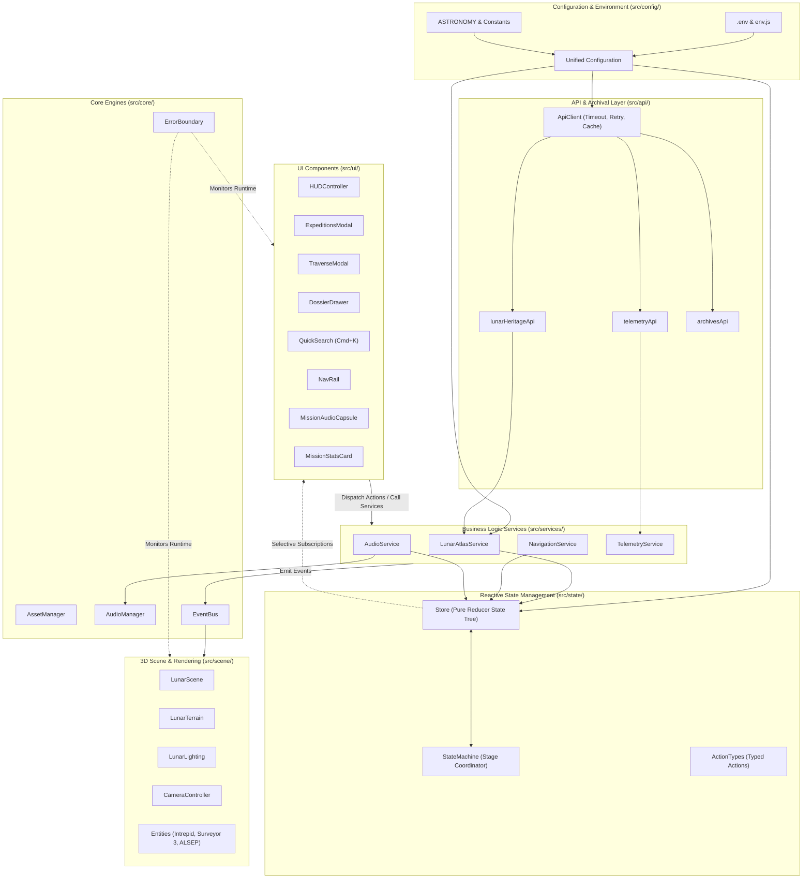

# AFTERLIGHT — System Architecture & Engineering Guide

## 1. Executive Architecture Summary

AFTERLIGHT is an immersive living archival monument and digital reconstruction of Apollo 12 (**Statio Cognitum**, $3.01239^\circ\text{ S}, 23.42157^\circ\text{ W}$) and humanity's global planetary heritage across the Moon.

The application is structured into decoupled, scalable subsystems:
- **API Layer (`src/api/`):** Standardized, abort-capable HTTP client with retry logic, exponential backoff, caching, and offline-first fallbacks.
- **Config & Environment (`src/config/`):** Immutable runtime configuration validated from Vite environment variables and IAU planetary standards.
- **Core Runtime (`src/core/`):** Central asset manager with in-flight deduplication, positional 3D spatial Web Audio engine, event bus, and runtime error boundary.
- **State Management (`src/state/`):** Central reactive store with pure action dispatching, fine-grained slice subscriptions, and lifecycle state machine.
- **Service Layer (`src/services/`):** Pure business logic decoupled from UI (Lunar Atlas, Audio, Navigation, Telemetry).
- **Presentation Layer (`src/ui/`):** High-legibility UI components and modals adhering to field-instrument aesthetics.
- **3D Graphics Engine (`src/scene/`, `src/entities/`):** WebGL Three.js lunar surface, procedural regolith shader, celestial Earth/Sun, and Apollo 12 artifacts.
- **Utilities (`src/utils/`):** Spherical trigonometry (Haversine distance and topocentric bearing), structured logger, DOM helpers, formatters.

---

## 2. Directory Tree Structure

```
Afterlight/
├── .env                          # Local environment variables
├── .env.example                  # Environment configuration template
├── package.json
├── vite.config.js                # Vite build config with path aliases (@ -> src)
├── index.html                    # Entry HTML shell
├── assets/                       # Static 3D models (GLTF/OBJ), textures, and archives
├── docs/                         # Engineering audits, checklists, and architecture
│   └── ARCHITECTURE.md
└── src/
    ├── main.js                   # Application bootstrap & lifecycle orchestrator
    ├── api/                      # Scalable API subsystem
    │   ├── client.js             # Base ApiClient with timeout, retry & cache
    │   ├── index.js              # Central API export
    │   └── endpoints/
    │       ├── archives.js       # Archival records & transcripts API
    │       ├── lunarHeritage.js  # Planetary heritage & rovers registry API
    │       └── telemetry.js      # Surface environmental telemetry API
    ├── config/                   # Configuration & environment variables
    │   ├── constants.js          # IAU astronomical constants, stages & presets
    │   ├── env.js                # Typed, validated environment loader
    │   └── index.js
    ├── core/                     # Runtime engines
    │   ├── AssetManager.js       # Cached 3D model/texture loader with cloning
    │   ├── AudioManager.js       # Web Audio synthesizer & 3D HRTF beacons
    │   ├── ErrorBoundary.js      # Global unhandled error & promise rejection catcher
    │   ├── EventBus.js           # Decoupled publish/subscribe event bus
    │   └── StateMachine.js       # Stage lifecycle coordinator synced with Store
    ├── data/                     # Pure historical & cartographic datasets
    │   ├── artifactsData.js      # Apollo 12 in situ hardware specifications
    │   ├── lunarHeritageData.js  # Catalog of all 18 lunar sites & 9 rovers
    │   └── traverseData.js       # EVA-1 & EVA-2 traverse route stations
    ├── entities/                 # 3D Three.js scene meshes & fiducials
    │   ├── ALSEP.js              # Apollo Lunar Surface Experiments Package
    │   ├── FlagAndEquipment.js   # US Flag, solar wind foil, TV camera
    │   ├── LunarModule.js        # LM-6 Intrepid descent stage & ladder
    │   ├── Surveyor3.js          # Surveyor 3 robotic lander in crater
    │   └── WaypointMarkers.js    # 3D projected screen fiducials
    ├── scene/                    # Three.js 3D environment & shaders
    │   ├── CameraController.js   # Orbit & tween camera controller
    │   ├── LunarLighting.js      # Physically plausible Sun, Earth & starfield
    │   ├── LunarScene.js         # Core scene graph, render loop & resize
    │   ├── LunarTerrain.js       # LROC-accurate topography mesh
    │   ├── RegolithMaterial.js   # Custom lunar regolith shader
    │   ├── SpatialProjector.js   # In-scene historical photo projector
    │   └── SplinePathEngine.js   # Cinematic spline camera trajectories
    ├── services/                 # Business logic separated from UI
    │   ├── AudioService.js       # Quindar tones, UI blips, ambient ventilation
    │   ├── LunarAtlasService.js  # Great-circle calculations, rover filtering, search
    │   ├── NavigationService.js  # Camera preset switching & transitions
    │   ├── TelemetryService.js   # Site environmental telemetry ingest
    │   └── index.js
    ├── state/                    # Central reactive state management
    │   ├── actions.js            # Standardized, typed action constants
    │   └── Store.js              # Pure reducer store with slice subscriptions
    ├── styles/                   # Modular CSS stylesheets
    │   ├── approach.css          # Intro splash overlay
    │   ├── dossier.css           # Artifact archival inspection drawer
    │   ├── expeditions.css       # Global lunar atlas & rovers modal
    │   ├── hud.css               # Field-instrument HUD & observation bar
    │   ├── main.css              # Typography, CSS variables & canvas
    │   ├── traverse.css          # Cartographic EVA map
    │   ├── uiverse.css           # Astronaut UI component styling
    │   └── vidicon.css           # 1969 Surveyor scanline raster overlay
    ├── ui/                       # Pure presentation UI components
    │   ├── ApproachOverlay.js    # Cinematic entrance sequence
    │   ├── DossierDrawer.js      # In-depth artifact inspector
    │   ├── ExpeditionsModal.js   # Rovers & human heritage atlas
    │   ├── FallbackView.js       # Accessible non-WebGL 2D experience
    │   ├── HUDController.js      # Observation perspectives & top HUD
    │   ├── MissionAudioCapsule.js# Air-to-ground radio capsule & transcripts
    │   ├── MissionStatsCard.js   # Live geochemical & Surveyor proximity card
    │   ├── NavRail.js            # Quick-action dock navigation rail
    │   ├── QuickSearch.js        # Command palette (⌘ K) with relic indexing
    │   ├── TraverseModal.js      # EVA traverse geological stations modal
    │   └── VidiconOverlay.js     # 600-line slow-scan television mode
    └── utils/                    # Pure utility functions
        ├── astronomy.js          # Haversine distance & topocentric bearing
        ├── dom.js                # Safe element query & event attachment
        ├── formatters.js         # Coordinates, distance & HTML escaping
        └── logger.js             # Standardized leveled logging
```

---

## 3. Data Flow & Subsystem Architecture



---

## 4. State Management Specifications

The central store (`src/state/Store.js`) maintains an immutable state tree:

```typescript
interface RootState {
  app: {
    stage: 'APPROACH' | 'ENVIRONMENT' | 'INSPECTION' | 'TRAVERSE' | 'EXPEDITIONS';
    isLoading: boolean;
    isWebGLEnabled: boolean;
  };
  camera: {
    activePreset: 'OVERVIEW' | 'EYE_LEVEL' | 'SURVEYOR_RIM' | 'ALSEP_SITE' | 'CELESTIAL_EARTH';
    isTransitioning: boolean;
    surveyorProximity: number; // in meters (default 163m)
  };
  audio: {
    isMuted: boolean;
    volume: number;
  };
  inspection: {
    selectedArtifactId: string | null;
    selectedArtifact: object | null;
    isOpen: boolean;
  };
  modals: {
    isTraverseOpen: boolean;
    isExpeditionsOpen: boolean;
    isQuickSearchOpen: boolean;
    isVidiconActive: boolean;
    activeExpeditionId: string | null;
  };
  atlas: {
    activeFilter: 'ALL' | 'ROVERS' | 'APOLLO' | 'VANGUARD' | 'IMPACTS';
    searchQuery: string;
    selectedSiteId: string | null;
  };
}
```

UI components subscribe only to their relevant slice using fine-grained selectors:
```javascript
// Example: Component only re-renders when audio mute status changes
const unsubscribe = store.subscribe(
  (state) => state.audio.isMuted,
  (isMuted) => {
    button.classList.toggle('is-active', !isMuted);
    statusText.textContent = isMuted ? 'AUDIO: MUTED' : 'AUDIO: LIVE';
  }
);
```

---

## 5. Spherical Navigation & Astronomy Formulation

All distances and bearings across the Moon are derived from first-principles spherical trigonometry in `src/utils/astronomy.js`:

1. **Great-Circle Surface Distance (Haversine Formula):**
   $$\Delta\sigma = 2 \arcsin\left(\sqrt{\sin^2\left(\frac{\Delta\phi}{2}\right) + \cos\phi_1\cos\phi_2\sin^2\left(\frac{\Delta\lambda}{2}\right)}\right)$$
   $$D = R_{\text{Moon}} \cdot \Delta\sigma \quad (R_{\text{Moon}} = 1,737.4\text{ km})$$

2. **Topocentric Compass Bearing:**
   $$\theta = \text{atan2}\left(\sin\Delta\lambda \cos\phi_2, \; \cos\phi_1\sin\phi_2 - \sin\phi_1\cos\phi_2\cos\Delta\lambda\right)$$
   $$\text{Bearing} = (\theta \cdot \frac{180}{\pi} + 360) \pmod{360}$$

---

## 6. Error Handling Strategy

1. **Global Error Boundary (`src/core/ErrorBoundary.js`):** Intercepts `window.onerror` and `window.onunhandledrejection`. Prevents silent application failures by capturing structured diagnostic logs and rendering an interactive recovery banner without blocking the interface.
2. **API Normalization (`src/api/client.js`):** Normalizes network errors into typed `ApiError` instances with HTTP status codes and details. Automatically retries idempotent GET requests with exponential backoff.
3. **WebGL Degradation:** If WebGL context creation fails or hardware lacks 3D capability, the application gracefully initializes `FallbackView.js`, delivering an accessible, high-performance archival interface.
