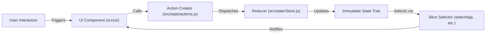

# AFTERLIGHT — Architecture & Codebase Organization Standard

> **Document Version:** 2.0.0  
> **Target Release:** Commercial & Production Standards  
> **Primary Coordinates:** Apollo 12 *Statio Cognitum* ($3.01239^\circ\text{ S}, 23.42157^\circ\text{ W}$) & Global Lunar Heritage Network

---

## 1. Architectural Philosophy & Design Principles

AFTERLIGHT is built with a zero-bloat, framework-agnostic architecture engineered for maximum longevity, extreme rendering fidelity, and strict separation of concerns.

```
       ┌────────────────────────────────────────────────────────┐
       │                   Presentation Layer                   │
       │     (Pure DOM Views: src/ui/, Templates: *.html)       │
       └───────────────────────────┬────────────────────────────┘
                                   │  Dispatches User Actions
                                   │  Subscribes to Slice Selectors
                                   ▼
       ┌────────────────────────────────────────────────────────┐
       │                State Management & Store                │
       │  (Central Store: src/state/Store.js, actions.js)       │
       └──────────────┬───────────────────────────▲─────────────┘
                      │                           │
                      │ Queries State             │ Dispatches State
                      ▼                           │ Transitions
       ┌──────────────────────────────────────────┴─────────────┐
       │                 Domain & Service Layer                 │
       │    (Business Logic: src/services/, EventBus)           │
       └──────────────┬───────────────────────────▲─────────────┘
                      │ Calls Data APIs           │ Emits Domain Events
                      ▼                           │
       ┌───────────────────────────┐ ┌────────────┴─────────────┐
       │     API & Data Layer      │ │   3D WebGL Scene Engine  │
       │  (src/api/, src/data/)    │ │  (src/scene/, entities/) │
       └───────────────────────────┘ └──────────────────────────┘
```

### Core Tenets
1. **Separation of Concerns:** UI components (`src/ui/`) strictly handle DOM manipulation, user events, and presentation styling. They contain **zero** spherical trigonometry, raw SVG calculation algorithms, or direct data mutations.
2. **Decoupled Business Logic (`src/services/`):** All calculations (geodetic distances, traverse bearings, SVG path generation, telemetry parsing, audio synthesis logic) live inside dedicated service singletons.
3. **Unidirectional Reactive State:** The central store (`src/state/Store.js`) holds all application state slices. State changes are exclusively dispatched via typed action creators (`src/state/actions.js`). Components read state through memoized slice selectors (`selectApp`, `selectCamera`, `selectModals`, etc.).
4. **Resilient Error Boundaries:** Errors are caught and handled across three distinct tiers:
   - *Application Tier:* `src/core/ErrorBoundary.js` catches unhandled exceptions and promise rejections with graceful fallback rendering (`src/ui/FallbackView.js`).
   - *Graphics Tier:* WebGL context loss listeners (`webglcontextlost`, `webglcontextrestored`) and visibility change detection protect the GPU pipeline from crash loops. Individual entity spawns are isolated in `try...catch` boundaries in `GlobalSiteManager.js`.
   - *Network Tier:* `src/api/client.js` normalizes HTTP failures into `ApiError` objects, applying automated exponential backoff retry algorithms.
5. **Strict Environment Decoupling:** Environment settings and IAU physical constants are loaded and validated via `src/config/env.js` and `.env.example`, completely isolating runtime variables from business code.

---

## 2. Directory Tree & Responsibility Matrix

```
Afterlight/
├── .env.example                               # Canonical template of runtime environment variables
├── index.html                                 # Apollo 12 Statio Cognitum interactive surface app
├── package.json                               # Dependencies & build scripts
├── vite.config.js                             # Vite bundler configuration & path aliases
├── vercel.json                                # Edge routing, security headers & clean rewrites
├── public/                                    # Public static web assets
│   ├── favicon.svg                            # Vector favicon
│   ├── favicon.ico                            # Fallback multi-resolution icon
│   ├── favicon-16x16.png                      # 16px raster favicon
│   ├── favicon-32x32.png                      # 32px raster favicon
│   ├── apple-touch-icon.png                   # 180px iOS home screen icon
│   ├── android-chrome-192x192.png             # 192px PWA icon
│   ├── android-chrome-512x512.png             # 512px PWA icon
│   ├── site.webmanifest                       # Web application manifest
│   ├── robots.txt                             # Web crawler permissions
│   └── globe.html                             # 3D Photorealistic Global Lunar Heritage & Design Lab
├── assets/                                    # Canonical shared 3D & media assets
│   ├── 3d_models/                             # GLTF & OBJ models (Apollo LM, Surveyor 3, ALSEP, etc.)
│   ├── terrain_and_cartography/               # LROC DEM elevation & normal maps, GeoJSON traverses
│   ├── photography/                           # High-res 70mm Hasselblad surface scans & metadata
│   ├── schematics_and_diagrams/               # Technical vector diagrams (SVG)
│   └── visual_references_and_mood/            # Photometric references & audio design specifications
├── docs/                                      # Technical, historical & architectural documentation
│   ├── ARCHITECTURE_AND_FOLDER_STRUCTURE.md   # This comprehensive architectural standard
│   ├── ARCHITECTURE.md                        # High-level system architecture & engineering guide
│   ├── SCIENTIFIC_INTEGRITY.md                # Geodetic standards & historical validation protocol
│   └── LICENSING_AND_ATTRIBUTION.md           # Rights management & NASA attribution documentation
└── src/                                       # Application Source Code
    ├── main.js                                # Main entry point orchestrating bootstrap & error recovery
    ├── api/                                   # Scalable API subsystem
    │   ├── client.js                          # Base ApiClient with retry, timeout & caching
    │   ├── index.js                           # Unified API facade with active health check
    │   └── endpoints/                         # Specialized endpoint modules
    │       ├── archives.js                    # Archival transcripts & documents endpoint
    │       ├── lunarHeritage.js               # Global lunar landing sites & rovers registry endpoint
    │       └── telemetry.js                   # Environmental surface telemetry endpoint
    ├── config/                                # Environment variables & system constants
    │   ├── constants.js                       # IAU astronomical constants, stages & camera presets
    │   ├── env.js                             # Typed environment configuration loader
    │   └── index.js                           # Unified config export
    ├── core/                                  # Foundation runtime engines
    │   ├── AssetManager.js                    # Deduplicated 3D asset & texture loader with cloning
    │   ├── AudioManager.js                    # Web Audio synthesis & spatial 3D audio engine
    │   ├── ErrorBoundary.js                   # Central error interception & logging
    │   ├── EventBus.js                        # Lightweight publish/subscribe event dispatcher
    │   └── StateMachine.js                    # Deterministic stage lifecycle controller
    ├── data/                                  # Historical datasets & geodetic registries
    │   ├── artifactsData.js                   # In situ hardware specifications & 3D metadata
    │   ├── globalLunarData.js                 # Global lunar coordinates, missions & surface features
    │   ├── lunarHeritageData.js               # Definitive catalog of all 18 lunar sites & 9 rovers
    │   └── traverseData.js                    # Apollo 12 EVA-1 & EVA-2 traverse paths & stations
    ├── entities/                              # 1:1 Scale 3D Spacecraft & Instrument Meshes
    │   ├── ALSEP.js                           # Apollo Lunar Surface Experiments Package Array A
    │   ├── ApolloLRV.js                       # Apollo Lunar Roving Vehicle 1:1 procedural mesh
    │   ├── FlagAndEquipment.js                # US Surface Flag, solar wind collector, TV camera
    │   ├── LunarModule.js                     # LM-6 Intrepid descent stage & boarding ladder
    │   ├── LunokhodRover.js                   # Soviet Lunokhod 1 & 2 rovers 1:1 procedural mesh
    │   ├── PragyanRover.js                    # Chandrayaan-3 Pragyan rover 1:1 procedural mesh
    │   ├── SLIMSoraQ.js                       # JAXA SLIM lander & LEV-2 Sora-Q 1:1 procedural mesh
    │   ├── SovietLunaLander.js                # Soviet Luna 9, 16, 17, 20, 24 1:1 procedural mesh
    │   ├── Surveyor3.js                       # Surveyor 3 soft lander & sampling scoop
    │   ├── WaypointMarkers.js                 # 3D projected interactive screen fiducials
    │   └── YutuRover.js                       # Chang'e 3 & 4 Yutu rovers 1:1 procedural mesh
    ├── scene/                                 # WebGL Graphics Engine (Three.js)
    │   ├── CameraController.js                # OrbitControls & cinematic camera tweening
    │   ├── GlobalSiteManager.js               # Macro-to-micro site transitions & entity positioning
    │   ├── LunarLighting.js                   # Sun radiation, Earthshine & starfield skybox
    │   ├── LunarScene.js                      # Three.js scene graph, animation loop & context management
    │   ├── LunarTerrain.js                    # LROC DEM terrain mesh with displacement mapping
    │   ├── RegolithMaterial.js                # Hapke opposition surge / Heiligenschein PBR shader
    │   ├── SpatialProjector.js                # In-scene historical photo frustum projector
    │   └── SplinePathEngine.js                # Smooth Catmull-Rom spline camera flyover trajectories
    ├── services/                              # Decoupled Domain & Business Logic
    │   ├── AudioService.js                    # Quindar beeps, UI feedback, ambient ventilation tones
    │   ├── LunarAtlasService.js               # Spherical distance, rover categorization, search & filtering
    │   ├── NavigationService.js               # Camera waypoint navigation & coordinate conversion
    │   ├── TelemetryService.js                # Real-time environmental telemetry streaming
    │   ├── TraverseService.js                 # EVA route math, SVG path generation & station lookups
    │   └── index.js                           # Unified service exports
    ├── state/                                 # Centralized Reactive State Management
    │   ├── actions.js                         # Typed action creators & ActionTypes constants
    │   └── Store.js                           # Redux-style store with reducer & memoized slice selectors
    ├── styles/                                # Scoped Component Stylesheets
    │   ├── approach.css                       # Landing entrance overlay animations
    │   ├── dossier.css                        # In-depth artifact inspection drawer
    │   ├── expeditions.css                    # Global Lunar Heritage & Rover Atlas modal
    │   ├── hud.css                            # Observation toolbar & telemetry badges
    │   ├── kawai-text.css                     # Monospace typographic treatments
    │   ├── main.css                           # Global resets, design tokens & canvas layout
    │   ├── traverse.css                       # EVA cartographic modal & geological paths
    │   ├── uiverse.css                        # Astronaut HUD controls & toggle switches
    │   └── vidicon.css                        # 1969 Surveyor 600-line slow-scan TV raster overlay
    ├── ui/                                    # Pure Presentation UI Views
    │   ├── ApproachOverlay.js                 # Initial cinematic splash overlay
    │   ├── ArtifactHoloViewer.js              # 3D Holographic artifact inspection viewport
    │   ├── DossierDrawer.js                   # Technical artifact dossier sheet
    │   ├── ExpeditionsModal.js                # Interactive Rovers & Sites browser
    │   ├── FallbackView.js                    # Zero-WebGL accessible 2D archival fallback
    │   ├── HUDController.js                   # Primary telemetry HUD & camera preset controls
    │   ├── MissionAudioCapsule.js             # Air-to-ground radio capsule with audio visualizer
    │   ├── MissionStatsCard.js                # Live geochemical & Surveyor proximity card
    │   ├── NavRail.js                         # Bottom/side quick-navigation dock
    │   ├── QuickSearch.js                     # Instant search palette (Cmd+K / Ctrl+K)
    │   ├── TraverseModal.js                   # Visual EVA cartography modal with SVG traverse map
    │   └── VidiconOverlay.js                  # Scanline TV raster & camera telemetry HUD
    └── utils/                                 # Pure Mathematical & Helper Utilities
        ├── astronomy.js                       # Spherical Haversine distance & topocentric azimuth
        ├── dom.js                             # Safe DOM querying & event delegation
        ├── formatters.js                      # Lat/Long coordinates, distance & XSS sanitization
        └── logger.js                          # Leveled, structured console logging engine
```

---

## 3. Separation of Business Logic & View Architecture

Prior to refactoring, certain UI components performed heavy data aggregation, raw array filtering, and SVG vector path string construction directly within DOM render loops. The architecture now strictly enforces the following separation:

### Case Study: Cartographic Traverse (`TraverseModal.js` vs `TraverseService.js`)
- **`TraverseService.js` (Domain Logic):**
  - Encapsulates station coordinate transformations and normalization into SVG viewBox space ($[x, y] \to [X_{\text{svg}}, Y_{\text{svg}}]$).
  - Calculates total route distance ($1,350\text{ m}$ for EVA-1, $1,570\text{ m}$ for EVA-2).
  - Builds SVG quadratic Bézier curve command strings (`M x y Q cx cy x2 y2`).
  - Provides station lookups by identifier and route filter queries.
- **`TraverseModal.js` (Presentation View):**
  - Renders DOM elements and applies CSS classes.
  - Attaches click listeners to SVG station points.
  - Updates text nodes with pre-formatted data delivered by `traverseService`.

### Case Study: Planetary Atlas (`ExpeditionsModal.js` vs `LunarAtlasService.js`)
- **`LunarAtlasService.js` (Domain Logic):**
  - Maintains indexes of all 18 lunar landing sites and 9 robotic rovers.
  - Computes category counts (`ALL`, `ROVERS`, `APOLLO`, `VANGUARD`, `IMPACTS`).
  - Computes great-circle distances and relative bearings from Statio Cognitum using the spherical Haversine formula:
    $$\Delta\sigma = 2 \arcsin\left(\sqrt{\sin^2\left(\frac{\Delta\phi}{2}\right) + \cos\phi_1\cos\phi_2\sin^2\left(\frac{\Delta\lambda}{2}\right)}\right)$$
    $$d = R_{\text{Moon}} \cdot \Delta\sigma \quad (R_{\text{Moon}} = 1,737.4\text{ km})$$
- **`ExpeditionsModal.js` (Presentation View):**
  - Subscribes to the modal visibility state and filter slice.
  - Invokes `lunarAtlasService.filterSitesSync(filter, query)`.
  - Injects pre-sanitized HTML cards and delegates click events to the action dispatcher.

---

## 4. State Management & Data Flow Architecture

The central store (`src/state/Store.js`) implements an immutable Redux-style state tree.



### State Slices & Available Selectors
1. **Application Lifecycle (`state.app`):**
   - `selectApp(state)`
   - `selectAppStage(state)`: `'APPROACH'` | `'ENVIRONMENT'` | `'INSPECTION'` | `'TRAVERSE'` | `'EXPEDITIONS'`
   - `selectIsLoading(state)`: Boolean loading indicator
   - `selectIsWebGLEnabled(state)`: Boolean GPU readiness
2. **Camera & Navigation (`state.camera`):**
   - `selectCamera(state)`
   - `selectActivePreset(state)`: `'OVERVIEW'` | `'EYE_LEVEL'` | `'SURVEYOR_RIM'` | `'ALSEP_SITE'` | `'CELESTIAL_EARTH'`
   - `selectIsCameraTransitioning(state)`: Boolean animation flag
   - `selectSurveyorProximity(state)`: Distance in meters (default $163\text{ m}$)
3. **Audio Subsystem (`state.audio`):**
   - `selectAudio(state)`
   - `selectIsAudioMuted(state)`: Boolean mute status
   - `selectAudioVolume(state)`: Normal range $[0.0, 1.0]$
4. **Hardware Inspection (`state.inspection`):**
   - `selectInspection(state)`
   - `selectSelectedArtifact(state)`: Active hardware entity spec
5. **Modals & Overlays (`state.modals`):**
   - `selectModals(state)`
   - `selectIsTraverseOpen(state)`: Cartography modal state
   - `selectIsExpeditionsOpen(state)`: Expeditions atlas state
   - `selectIsQuickSearchOpen(state)`: Command palette state
   - `selectIsVidiconActive(state)`: Scanline overlay state
6. **Lunar Atlas (`state.atlas`):**
   - `selectAtlas(state)`
   - `selectAtlasFilter(state)`: Active category filter

---

## 5. API Architecture & Error Handling Strategy

### Scalable Unified API Facade (`src/api/index.js`)
All network interactions are encapsulated behind the unified `api` client facade:
```javascript
import { api } from '@/api';

// Retrieve Apollo 12 surface transcripts with automated backoff retry
const transcripts = await api.archives.getTranscripts('APOLLO_12');

// Ingest live environmental surface telemetry
const telemetry = await api.telemetry.getSurfaceTelemetry();

// Query planetary heritage registry
const sites = await api.heritage.getAllSites();

// Active health check for production monitoring
const isHealthy = await api.checkHealth();
```

### Three-Tier Error Handling Pipeline
1. **Bootstrap & Main Loop Containment (`src/main.js`):**
   The application bootstrap sequence is wrapped in a top-level `try...catch` block. In the event of an unrecoverable failure during Three.js initialization, `errorBoundary.handleError(err, 'BootstrapFailure')` renders `FallbackView.js` to ensure the user is never left with a blank or broken screen.
2. **3D Entity Spawn Isolation (`GlobalSiteManager.js`):**
   When transitioning between global lunar sites, procedural 3D model generation for individual hardware packages is wrapped in local error boundaries. A failure to build a specific rover or lander logs a warning and isolates the faulty entity without interrupting camera travel or scene rendering.
3. **GPU Context Loss & Background Tab Throttling (`LunarScene.js`, `globe.html`):**
   - `webglcontextlost`: Immediately halts the `requestAnimationFrame` loop, cancels active tweens, and displays a non-blocking recovery banner.
   - `webglcontextrestored`: Re-binds shaders, re-uploads textures, and smoothly resumes the animation loop.
   - `visibilitychange`: Automatically pauses Three.js rendering loops when the browser tab is hidden, eliminating wasted CPU/GPU cycles and thermal throttling.

---

## 6. Environment Configuration Standard

All environment variables follow strict naming conventions prefixed with `VITE_`:

| Variable | Type | Default Value | Description |
| :--- | :--- | :--- | :--- |
| `VITE_APP_TITLE` | `string` | `"AFTERLIGHT"` | Application title displayed in headers & metadata |
| `VITE_APP_STATION` | `string` | `"STATIO_COGNITUM"` | Default active lunar landing site code |
| `VITE_APP_LATITUDE` | `number` | `-3.01239` | Primary station selenographic latitude ($^\circ\text{S}$) |
| `VITE_APP_LONGITUDE` | `number` | `-23.42157` | Primary station selenographic longitude ($^\circ\text{W}$) |
| `VITE_API_BASE_URL` | `string` | `""` | Optional base URL for remote microservices |
| `VITE_API_TIMEOUT` | `number` | `10000` | HTTP request timeout limit in milliseconds |
| `VITE_DEBUG_MODE` | `boolean` | `false` | Enables verbose console logging and Three.js helpers |
| `VITE_ENABLE_ANALYTICS` | `boolean` | `false` | Privacy-preserving telemetry flag |

The `.env.example` file in the project root serves as the definitive reference template for all deployment environments.
