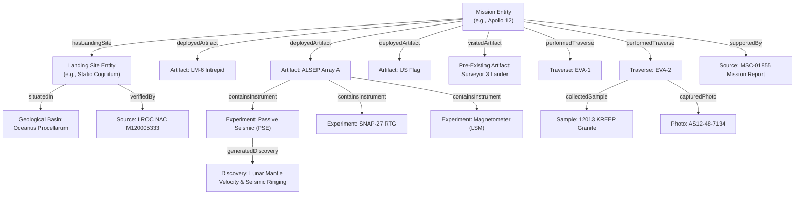

# AFTERLIGHT — Global Archive Data Schema & Relational Ontology

**Project:** AFTERLIGHT — The Living Archival Monument  
**Document ID:** DOC-GDS-012  
**Format:** JSON Schema (Draft 2020-12 Compatible) / Relational Graph Ontology  
**Purpose:** Standardizing Interconnected Entities Across Global Lunar Missions, Locations, Artifacts, and Scientific Discoveries  

---

## 1. Relational Graph Model & Interconnectivity

To avoid isolated silos of text, the AFTERLIGHT knowledge system is organized as an **interconnected knowledge graph**. Every physical object, landing site, astronaut EVA, and scientific instrument links explicitly to its parent mission, geological setting, and primary literature:



---

## 2. Core Entity JSON Schema Definitions

### 2.1 Mission Schema (`lunar_mission.schema.json`)
```json
{
  "$schema": "https://json-schema.org/draft/2020-12/schema",
  "$id": "https://afterlight.lunar/schemas/mission.json",
  "title": "LunarMission",
  "type": "object",
  "required": [
    "id",
    "name",
    "designation",
    "agency",
    "country",
    "era",
    "missionType",
    "outcome",
    "launchDate",
    "sourceReferences"
  ],
  "properties": {
    "id": { "type": "string", "pattern": "^[a-z0-9-]+$" },
    "name": { "type": "string" },
    "designation": { "type": "string" },
    "agency": { "type": "string" },
    "country": { "type": "string" },
    "era": {
      "type": "string",
      "enum": [
        "ERA_01_FIRST_CONTACTS",
        "ERA_02_FIRST_LANDINGS",
        "ERA_03_CREWED_APOLLO",
        "ERA_04_ROBOTIC_DORMANT",
        "ERA_05_MODERN_ORBITAL",
        "ERA_06_NEW_RENAISSANCE"
      ]
    },
    "missionType": {
      "type": "string",
      "enum": ["CREWED_LANDING", "ROBOTIC_LANDER", "ROBOTIC_ROVER", "SAMPLE_RETURN", "IMPACTOR", "ORBITER", "FLYBY"]
    },
    "outcome": {
      "type": "string",
      "enum": [
        "SOFT_LANDING_SUCCESS",
        "HARD_IMPACT_INTENTIONAL",
        "HARD_IMPACT_UNINTENTIONAL",
        "ORBITAL_MISSION",
        "FLYBY_MISSION",
        "PLANNED_FUTURE"
      ]
    },
    "launchDate": { "type": "string", "format": "date-time" },
    "arrivalDate": { "type": ["string", "null"], "format": "date-time" },
    "touchdownDate": { "type": ["string", "null"], "format": "date-time" },
    "surfaceStayDurationHours": { "type": ["number", "null"] },
    "crew": {
      "type": "array",
      "items": {
        "type": "object",
        "properties": {
          "name": { "type": "string" },
          "role": { "type": "string" },
          "walkedOnMoon": { "type": "boolean" }
        }
      }
    },
    "landingSiteId": { "type": ["string", "null"] },
    "deployedArtifactIds": { "type": "array", "items": { "type": "string" } },
    "sourceReferences": { "type": "array", "items": { "type": "string" } }
  }
}
```

---

### 2.2 Location Schema (`lunar_location.schema.json`)
```json
{
  "$schema": "https://json-schema.org/draft/2020-12/schema",
  "$id": "https://afterlight.lunar/schemas/location.json",
  "title": "LunarLocation",
  "type": "object",
  "required": [
    "id",
    "name",
    "latitude",
    "longitude",
    "uncertaintyRadiusMeters",
    "hemisphere",
    "geologicalRegion",
    "referenceDatum"
  ],
  "properties": {
    "id": { "type": "string", "pattern": "^[a-z0-9-]+$" },
    "name": { "type": "string" },
    "officialNameIAU": { "type": ["string", "null"] },
    "latitude": { "type": "number", "minimum": -90.0, "maximum": 90.0 },
    "longitude": { "type": "number", "minimum": -180.0, "maximum": 180.0 },
    "elevationMeters": { "type": ["number", "null"] },
    "uncertaintyRadiusMeters": { "type": "number", "minimum": 0.0 },
    "hemisphere": { "type": "string", "enum": ["NEAR_SIDE", "FAR_SIDE", "NORTH_POLAR", "SOUTH_POLAR"] },
    "geologicalRegion": { "type": "string" },
    "basinName": { "type": ["string", "null"] },
    "referenceDatum": { "type": "string", "default": "Mean Earth/Polar Axis (IAU/IAG, R=1737.4 km)" },
    "lrocPdsProductId": { "type": ["string", "null"] },
    "associatedMissionId": { "type": "string" }
  }
}
```

---

### 2.3 Artifact Schema (`lunar_artifact.schema.json`)
```json
{
  "$schema": "https://json-schema.org/draft/2020-12/schema",
  "$id": "https://afterlight.lunar/schemas/artifact.json",
  "title": "LunarArtifact",
  "type": "object",
  "required": [
    "id",
    "name",
    "category",
    "missionId",
    "locationId",
    "manufacturer",
    "dryMassKg",
    "currentConditionStatus",
    "has3dModelAsset"
  ],
  "properties": {
    "id": { "type": "string" },
    "name": { "type": "string" },
    "designation": { "type": "string" },
    "category": {
      "type": "string",
      "enum": [
        "DESCENT_STAGE",
        "PLANETARY_ROVER",
        "ROBOTIC_LANDER",
        "SCIENTIFIC_STATION",
        "RETROREFLECTOR",
        "RADIOISOTOPE_GENERATOR",
        "CAMERA_EQUIPMENT",
        "CREW_LIFE_SUPPORT",
        "NATIONAL_FLAG_OR_MARKER",
        "DISCARDED_HARDWARE"
      ]
    },
    "missionId": { "type": "string" },
    "locationId": { "type": "string" },
    "manufacturer": { "type": "string" },
    "dryMassKg": { "type": "number" },
    "envelopeDimensions": {
      "type": "object",
      "properties": {
        "heightMeters": { "type": "number" },
        "widthMeters": { "type": "number" },
        "lengthMeters": { "type": "number" }
      }
    },
    "currentConditionStatus": {
      "type": "string",
      "enum": [
        "INTACT_SURFACE_PRESERVED",
        "OPERATIONAL_ACTIVE",
        "SEVERED_PARTIALLY_RETRIEVED",
        "DISLODGED_TOPPLED",
        "SHATTERED_IMPACT_DEBRIS",
        "PHOTOCHEMICALLY_BLEACHED"
      ]
    },
    "has3dModelAsset": { "type": "boolean" },
    "modelAssetRelativePath": { "type": ["string", "null"] },
    "sourceReferences": { "type": "array", "items": { "type": "string" } }
  }
}
```

---

### 2.4 Flags & National Markers Schema (`lunar_flag.schema.json`)
```json
{
  "$schema": "https://json-schema.org/draft/2020-12/schema",
  "$id": "https://afterlight.lunar/schemas/flag.json",
  "title": "LunarFlagOrMarker",
  "type": "object",
  "required": [
    "id",
    "country",
    "missionId",
    "markerType",
    "deploymentDate",
    "materialComposition",
    "currentCondition",
    "outerSpaceTreatySovereigntyDisclaimer"
  ],
  "properties": {
    "id": { "type": "string" },
    "country": { "type": "string" },
    "missionId": { "type": "string" },
    "markerType": {
      "type": "string",
      "enum": [
        "FREE_STANDING_FABRIC_FLAG",
        "HULL_MOUNTED_FABRIC_FLAG",
        "KINETIC_SCATTERED_PENNANT",
        "EMBOSSED_WHEEL_TREAD_EMBLEM",
        "PAINTED_HULL_INSIGNIA"
      ]
    },
    "deploymentDate": { "type": "string", "format": "date-time" },
    "dimensionsCm": {
      "type": "object",
      "properties": {
        "width": { "type": "number" },
        "height": { "type": "number" }
      }
    },
    "materialComposition": { "type": "string" },
    "currentCondition": {
      "type": "string",
      "enum": [
        "STANDING_SEVERELY_DEGRADED",
        "STANDING_INTACT",
        "TOPPLED_ON_REGOLITH",
        "IMPACT_SCATTERED",
        "WHEEL_TREAD_IMPRINT"
      ]
    },
    "orbitalShadowConfirmation": { "type": "boolean" },
    "lrocObservationReference": { "type": ["string", "null"] },
    "outerSpaceTreatySovereigntyDisclaimer": {
      "type": "string",
      "default": "In accordance with Article II of the 1967 Outer Space Treaty, this marker represents symbolic human accomplishment and does not constitute a legal or territorial claim of national sovereignty."
    }
  }
}
```
