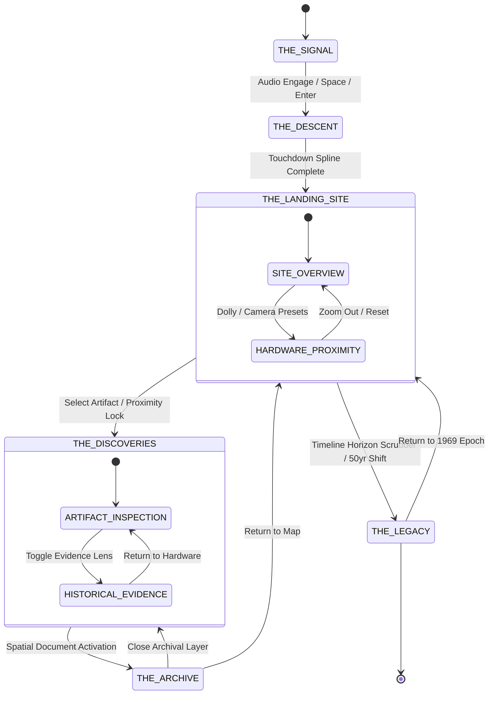
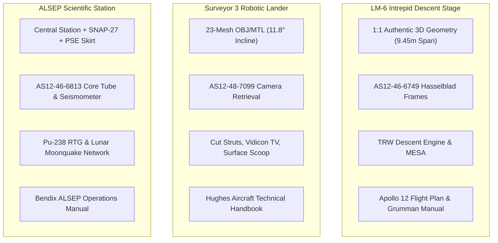
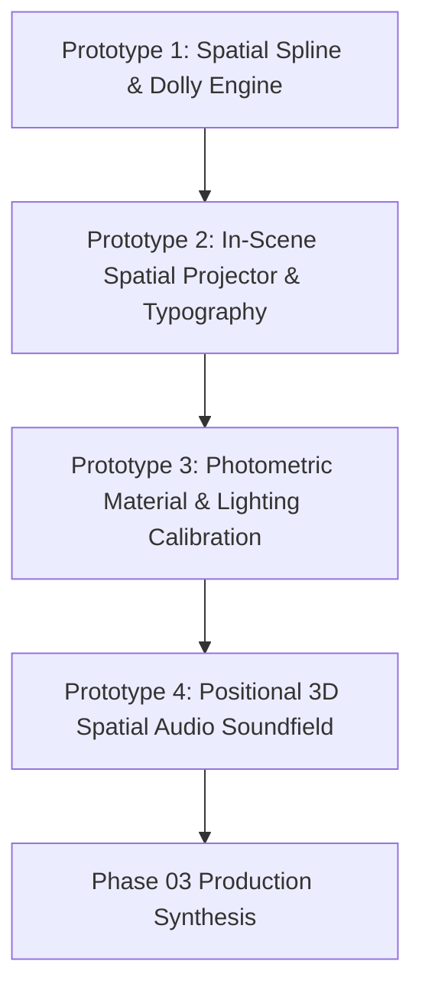

# AFTERLIGHT — PHASE 02: EXPERIENCE ARCHITECTURE & INTERACTION BLUEPRINT
**Creative Direction: THE LIVING ARCHIVAL MONUMENT**  
*A Studio-Quality Digital Installation for Apollo 12 and the Machines That Stayed Behind*

---

## 1. Executive Summary & Central Architectural Principle

### 1.1 The Central Design Principle
> *"AFTERLIGHT must feel like entering an extraordinary digital installation, not navigating a conventional website.*  
> *The Moon is the environment.  
> The artifacts are the protagonists.  
> The mission is the narrative.  
> The archive is the interface.*  
> *The experience itself must be the interface."*

Traditional web patterns—fixed navigation bars, standard modal overlays, generic glassmorphism cards, and sliding side drawers—are explicitly discarded in favor of an **integrated spatial experience**. In AFTERLIGHT, archival documentation, technical telemetry, and historical photography exist *inside the physical space of Statio Cognitum*, projected across the lunar terrain, anchored to hardware fiducials, and revealed through spatial proximity, camera choreography, and environmental illumination.

### 1.2 Approved Direction Synthesis: The Living Archival Monument
The Living Archival Monument harmonizes three distinct design modes established in Phase 01:
1. **Physical Realism & Environmental Immersion (Concept A — The Lunar Expedition)**: True 1:1 metric scale, physically accurate solar illumination at $13.5^\circ$ elevation, vacuum optical conditions (zero atmospheric scatter, infinite contrast, razor-sharp shadows), micro-relief regolith topography, and authentic Apollo 12 hardware models.
2. **Monumental Editorial Storytelling & Spatial Composition (Concept C — The Spatial Archive)**: Expansive, museum-grade spatial typography; typographic scales integrated directly into the 3D horizon; cinematic wide-angle ratios ($2.39:1$ anamorphic letterbox option); and poetic framing of human machines silently resting in extraterrestrial solitude.
3. **Scientific Investigation & Technical Depth (Concept B — The Digital Observatory)**: Interactive photogrammetric inspection, precision USGS/LROC coordinates, Hasselblad 70mm archival photography, authentic audio communications, and engineering schematics presented as optical projections on spatial planes.

---

## 2. Complete Visitor Journey: The Six Narrative States

The visitor experience is designed as an unbroken, continuous journey through six interconnected states. There are no page reloads, disruptive route changes, or artificial loading gates between states; every transition is handled through continuous camera splines, spatial audio shifts, and contextual interface metamorphosis.



### State 01: THE SIGNAL (Atmospheric Introduction & First Contact)
- **Experiential Intent**: Strip away earthly web expectations. Evoke the vast, silent void of cislunar space and the crackle of Apollo 12’s communications link across 380,000 km.
- **Visual Composition**: Deep obsidian space (`#010204`). No UI chrome. In the center, a solitary pulsating Reseau fiducial cross ($+$) with micro-coordinate telemetry: `STATIO COGNITUM // 3.01239° S, 23.42157° W`. A faint, razor-thin crescent of the lunar horizon glows subtly in the lower quadrant.
- **Audio Soundscape**: Sub-bass deep space drone ($42\text{ Hz}$ sine oscillation), faint electrical static, followed by an authentic Apollo 12 Quindar tone ($2525\text{ Hz}$) and Capcom astronaut comms: *"Intrepid, Houston. We see your descent engine status is GO..."*
- **Visitor Action**: Visitor clicks anywhere, presses `[SPACE]`, or scrolls downward.
- **Transition**: The audio expands into stereo cislunar space; the camera surges forward in an accelerating cinematic dolly toward the lunar crescent.

### State 02: THE DESCENT (Terminal Approach into Oceanus Procellarum)
- **Experiential Intent**: Relive Commander Pete Conrad’s manual landing approach into the Surveyor Crater rim, transitioning from high orbital velocity to pinpoint touchdown.
- **Visual Composition**: The camera tracks downward along a 3D Bézier spline, descending from $1,200\text{m}$ to $18\text{m}$ altitude. The curvature of the Moon expands across the screen. As altitude drops below $100\text{m}$, the low-angle sun reveals the long, cast shadows of Surveyor Crater, Head Crater, and Middle Crescent Crater. Fine dust scouring shockwaves radiate across the regolith surface under Intrepid's throttleable TRW descent engine.
- **Interface Elements**: Real-time terminal guidance radar telemetry projected directly onto the terrain: `ALT: 112M -> 45M -> 0M`, `DESCENT RATE: 3.2 FPS`, `LGC P66 ACTIVE`.
- **Audio**: Rising engine thruster resonance, telemetry callouts (*"Engine stop... 413 is in..."*), concluding with contact probe light illumination and a resonant physical thud as the landing gear settles on the basalt plain.
- **Transition**: Smooth deceleration into the site overview resting position; dust settles, silence returns.

### State 03: THE LANDING SITE (Exploration of Statio Cognitum)
- **Experiential Intent**: Open spatial exploration of the Apollo 12 landing site at authentic scale.
- **Visual Composition**: $360^\circ$ panoramic lunar environment. To the east, the sun sits low ($13.5^\circ$), casting stark $40\text{m}$ shadows across the crater rims. To the west, the Earth hangs as a brilliant blue-and-white marble suspended $64^\circ$ above the horizon.
- **Spatial Anchors**: In-scene spatial typography identifies the landmarks in 3D world space:
  - `LM-6 INTREPID` $[0, 0, 0]$
  - `SURVEYOR III` $[+72\text{m}, -11.5\text{m}, +150\text{m}]$ inside the south wall of Surveyor Crater
  - `ALSEP STATION` $[-106\text{m}, 0\text{m}, -75\text{m}]$
  - `US FLAG & MESA` $[0\text{m}, 0\text{m}, +7\text{m}]$
- **Navigation**: Dual-mode navigation:
  - *Cinematic Dolly*: Key shortcuts `[1]`, `[2]`, `[3]`, `[4]` or clicking floating spatial titles triggers smooth cinematic rail movements.
  - *Free Spatial Roam*: Smooth orbital panning and constrained ground-level dolly navigation with collision avoidance.

### State 04: THE DISCOVERIES (Encountering the Machines)
- **Experiential Intent**: Intimate, reverent encounter with the individual physical artifacts left behind on the surface.
- **Visual Composition**: Camera dollys into close inspection distance ($1.5\text{m}$ to $6.0\text{m}$). The artifact fills the frame. Photometric directional sunbeams highlight gold Kapton foil wrinkling, micrometeorite pits, Apollo 12 astronaut bolt cutters' severance marks on Surveyor 3’s camera strut, and thermal discoloration from unshielded solar UV radiation.
- **Spatial Metadata Layer**: Interactive hot points (fiducial markers) anchored to physical hardware subsystems:
  - LM-6: *Descent Propulsion Engine*, *MESA stowage*, *Egress Ladder*, *SNAP-27 Graphite Fuel Cask*.
  - Surveyor 3: *Vidicon TV Camera*, *Surface Sampler Scoop*, *Solar Panel Array*, *Star Tracker*.
  - ALSEP: *Central Station Transceiver*, *SNAP-27 RTG*, *Passive Seismic Experiment Mylar Skirt*.

### State 05: THE ARCHIVE (Spatial Mission Records & Evidence)
- **Experiential Intent**: Seamlessly view historical documentation without leaving the 3D scene.
- **Visual Composition**: Rather than opening an opaque web drawer, activating an archival record projects authentic NASA 70mm Hasselblad film frames, voice transcripts, and technical schematics as spatial planar artifacts directly beside the hardware in 3D space.
- **Interactive Capabilities**:
  - *High-Resolution Zoom*: Click any archival photograph to view raw 70mm scan detail.
  - *Comparative Lens*: Side-by-side juxtaposition of 1969 Hasselblad photograph and 3D reconstruction from the exact camera focal length ($60\text{mm}$ Zeiss Biogon).
  - *Audio Sync*: Voice transcript synchronized with authentic air-to-ground mission audio tapes.

### State 06: THE LEGACY (Millennial Horizon & Cosmic Solitude)
- **Experiential Intent**: Contemplate the enduring fate of these machines across deep time.
- **Visual Composition**: An interactive timeline scrubber allows the visitor to advance time from November 1969 to the present day and centuries into the future. The solar angle cycles through lunar day/night transitions ($29.5$ Earth days per lunar diurnal cycle). In the deep freeze of the lunar night ($-180^\circ\text{C}$), the Earth shines brightly, illuminating the gold foil of Intrepid in pale blue earthlight.
- **Narrative Resonance**: The audio fades into a solitary, resonant ambient soundscape. Spatial typography reveals the mission's physical legacy: *"These machines will remain intact for hundreds of thousands of years, slowly eroded only by the steady rain of cosmic micrometeorites."*

---

## 3. Spatial Interaction System Specification

Every interaction in AFTERLIGHT is physically grounded, intuitive, and designed to reveal narrative meaning.

| Trigger / Action | Visual Response | Spatial Response | Information Revealed | Design Rationale |
| :--- | :--- | :--- | :--- | :--- |
| **Hover on 3D Artifact** | Subtle golden fiducial glow on boundary; cursor transforms to target reticle. | Camera subtle focal depth-of-field shift; object bounding crosshairs align. | Subsystem designation, distance from current vantage, landing coordinates. | Immediate feedback that 3D objects are tangible, interactive protagonists. |
| **Direct Click on 3D Model** | Camera initiates smooth ease-in-out cinematic dolly track toward artifact. | Camera flies along collision-free cubic Bézier spline to canonical inspection station. | Primary artifact dossier, specifications, 70mm Hasselblad hero photograph. | Removes intermediate UI abstraction; direct manipulation of the physical world. |
| **Scroll / Trackpad Dolly** | Ground moves continuously; fine regolith gravel and micro-craters parallax at eye level. | Camera translates forward/backward along view vector, clamped to $1.6\text{m}$ above terrain. | Real-time azimuth bearing, elevation angle, and ground range telemetry. | Simulates astronaut EVAs walking across the regolith plains. |
| **Drag / Orbit Gesture** | Smooth rotational pan; sunlight catches gold Kapton foil specular highlights. | Camera orbits current focal target within calibrated polar angle limits ($10^\circ$ to $88^\circ$). | Angular perception of hardware geometry, cast shadow contours, crater depths. | Allows complete spatial comprehension of complex aerospace engineering. |
| **Key `[1]` to `[4]` / Vantage Rail** | Instant smooth camera glide with cinematic acceleration and deceleration. | Camera transitions between Site Overview, Astronaut Eye Level, Surveyor Rim, and ALSEP. | Contextual site card with geological unit, distance delta, and EVA station notes. | Fast travel for visitors seeking structured narrative stations. |
| **Click Reseau Marker ($+$)** | Crosshair brackets contract; label expands horizontally with crisp monospace typography. | Anchor points stay pinned to 3D world coordinates via projection matrix. | Station number, distance delta, historical activity log (e.g. "ALSEP deployed 130m NW"). | Authentic Apollo photogrammetry fiducial styling; zero clutter when idle. |
| **Key `[V]` / Vidicon Mode** | Scanlines, 600-line video raster, phosphorescent bloom, and 4:3 optical vignette activate. | Camera locks to Surveyor 3 vidicon mirror orientation (looking up at Intrepid). | Telemetry stream, azimuth/elevation angles, 1969 television scan telemetry. | Relives the historic first tele-robotic observation of a lunar landing. |
| **Key `[T]` / Traverse Toggle** | USGS cartographic map unfolds with animated dashed EVA 1 and EVA 2 paths. | Camera elevates slightly to provide top-down oblique view of traverse network. | 14 traverse geological stations, sample collection IDs, astronaut heart-rate zones. | Grounded historical geography connecting the isolated artifacts into a single expedition. |
| **Click Archival Photo** | Photo smoothly scales into full-screen high-resolution lightbox with matte black background. | 3D scene subtly softens with gentle depth blur ($1.5\text{px}$); zero heavy obscuration. | NASA photo ID, film magazine, camera lens specifications, original transcript quote. | Respects authentic primary historical sources as museum-grade documentary records. |

---

## 4. Camera Choreography & Navigation Architecture

### 4.1 Camera Spline & Dolly Engine
Camera movement is governed by a unified **CinematicSplineController** operating over cubic Hermite and Catmull-Rom splines in 3D space.


### 4.2 Canonical Camera Vantages & Presets
Each canonical station is calibrated to Apollo 12 historical documentation:

```javascript
export const CANONICAL_VANTAGES = {
  // Global site perspective: Intrepid in foreground, Surveyor Crater to south
  SITE_OVERVIEW: {
    position: { x: -35.0, y: 18.5, z: -48.0 },
    target: { x: 12.0, y: 0.0, z: 25.0 },
    fov: 42,
    duration: 3200,
    easing: 'easeInOutCubic',
    historicalNote: 'Approach perspective reconstructed from descent photography.'
  },
  
  // Astronaut Pete Conrad & Alan Bean Eye Level at LM Footpad
  LM_EYE_LEVEL: {
    position: { x: 8.5, y: 2.1, z: 9.8 },
    target: { x: 0.0, y: 2.4, z: 0.0 },
    fov: 48,
    duration: 2200,
    easing: 'easeInOutCubic',
    historicalNote: 'Astronaut eye level (1.75m elevation) facing Quad I MESA.'
  },
  
  // Surveyor Crater Rim: The dramatic rendezvous view
  SURVEYOR_RIM: {
    position: { x: 50.0, y: 3.2, z: 105.0 },
    target: { x: 72.0, y: -11.5, z: 150.0 },
    fov: 44,
    duration: 2600,
    easing: 'easeInOutCubic',
    historicalNote: 'Northwest rim of Surveyor Crater looking down at the robotic lander.'
  },
  
  // Surveyor 3 Close Inspection: Resting on the 11.8° crater slope
  SURVEYOR_CLOSE: {
    position: { x: 75.5, y: -9.8, z: 154.2 },
    target: { x: 72.0, y: -11.5, z: 150.0 },
    fov: 52,
    duration: 1800,
    easing: 'easeInOutCubic',
    historicalNote: 'Conrad and Bean inspecting the retrieved camera and scoop.'
  },
  
  // ALSEP Array A Deployment Field
  ALSEP_FIELD: {
    position: { x: -94.0, y: 2.8, z: -66.0 },
    target: { x: -106.0, y: 0.5, z: -75.0 },
    fov: 46,
    duration: 2400,
    easing: 'easeInOutCubic',
    historicalNote: '130m northwest of LM, safely outside rocket-exhaust scouring zone.'
  }
};
```

### 4.3 Terrain Collision & Clamping System
To maintain physical realism and prevent disorienting camera clippings:
1. **Dynamic Elevation Sampling**: On every frame, the camera's world position $(x, z)$ is evaluated against `getElevation(x, z)`.
2. **Minimum Altitude Clamping**:
   $$\text{cam.y} = \max(\text{cam.y},\, \text{getElevation}(\text{cam.x}, \text{cam.z}) + 1.6\text{m})$$
   This guarantees the camera never intersects the ground or penetrates crater walls.
3. **Hardware Bounding Volumes**: Cylindrical exclusion boundaries around LM-6 ($r = 4.2\text{m}$), Surveyor 3 ($r = 2.5\text{m}$), and ALSEP ($r = 3.0\text{m}$) deflect camera splines smoothly around fragile hardware antennas and struts.

---

## 5. Artifact-Specific Experience Designs

Each of the primary lunar artifacts features a dedicated discovery, investigation, and archival narrative.



### 5.1 Apollo 12 Lunar Module (LM-6 Intrepid) Descent Stage
- **Historical Context**: Launched November 14, 1969; touched down November 19, 1969. The first precision planetary landing in human history. Permanently resting in Oceanus Procellarum.
- **Physical Representation in AFTERLIGHT**:
  - Official NASA GLB 3D model with DRACO compression.
  - Authentic 1:1 scale: $9.45\text{m}$ diagonal landing gear footprint span; $3.23\text{m}$ descent stage height.
  - Double-sided textured gold and amber Kapton thermal insulation foil with physically based metallic micro-reflectance.
  - Forward landing gear strut fitted with the egress ladder and the signed commemorative stainless steel plaque.
  - Quadrant II Modular Equipment Stowage Assembly (MESA) deployed with thermal blankets.
  - Quadrant IV SNAP-27 graphite fuel transport cask mounted on the descent stage spaceframe.
- **Investigation Hotspots**:
  1. *TRW Throttleable Descent Propulsion System (DPS)*: Reveals engine exhaust interaction data and supersonic regolith scouring plumes.
  2. *Commemorative Plaque & Ladder*: High-resolution transcription of Conrad, Bean, Gordon, and Nixon signatures.
  3. *MESA Stowage Area*: Archival photography of Pete Conrad pulling the D-ring to deploy the color TV camera.
- **Archival Pairings**:
  - NASA photograph `AS12-46-6749` (Surveyor 3 with Intrepid in the distance).
  - NASA photograph `AS12-46-6739` (Pete Conrad at the MESA).
  - Full transcript of the historic "SCE to AUX" lightning strike recovery call.

### 5.2 Surveyor 3 Spacecraft (Robotic Precursor)
- **Historical Context**: Landed April 20, 1967. Visited by humans 31 months later on November 20, 1969. The only time in human history that astronauts visited a previously sent robotic lander.
- **Physical Representation in AFTERLIGHT**:
  - Authentic Phase 01 23-mesh OBJ/MTL model.
  - Placed at authentic coordinates: $163\text{m}$ southeast of Intrepid ($x = +72\text{m}, z = +150\text{m}$) inside Surveyor Crater.
  - Resting at elevation $-11.5\text{m}$ tilted at $11.8^\circ$ matching the crater's southeastern slope.
  - Materials calibrated to retrieved hardware analysis: white thermal paint discolored to tan-brown by 31 months of unshielded solar UV radiation; solar cell panel; planar high-gain planar antenna.
- **Investigation Hotspots**:
  1. *Vidicon TV Camera Housing*: Highlights the severed aluminum struts cut by Conrad and Bean with bolt cutters to return the camera to Earth.
  2. *Surface Sampler Scoop*: Reconstructs the remote mechanical trenching that tested soil bearing strength prior to Apollo.
  3. *Streptococcus Mitis Controversy*: Interactive briefing on the microbial spore debate discovered upon laboratory quarantine return.
- **Archival Pairings**:
  - NASA photograph `AS12-48-7133` (Astronaut Alan Bean examining Surveyor 3).
  - 1967 Surveyor 3 telemetry images transmitted from the lunar surface.
  - Hughes Aircraft Corporation engineering blue-line schematic.

### 5.3 ALSEP Array A: Central Station & Experiments
- **Historical Context**: Deployed November 19, 1969, at $305^\circ$ azimuth, $130\text{m}$ northwest of Intrepid. Transmitted geophysical data continuously to Earth until September 30, 1977.
- **Physical Representation in AFTERLIGHT**:
  - Three distinct authentic OBJ models:
    1. *ALSEP Central Station*: Bendix Aerospace data transmitter with S-Band helical antenna aimed at Earth ($64^\circ$ elevation in western sky).
    2. *SNAP-27 Radioisotope Thermoelectric Generator (RTG)*: GE Space Division high-emissivity beryllium casing containing $3.8\text{kg}$ of Plutonium-238 delivering $73.5\text{W}$ electrical power.
    3. *Passive Seismic Experiment (PSE)*: Columbia University / Lamont-Doherty seismometer enclosed in an aluminized Mylar 10-sided skirt.
  - Flat Kapton/Teflon ribbon power and data cabling connecting instruments across the regolith.
- **Investigation Hotspots**:
  1. *SNAP-27 Plutonium Core*: Fuel rod extraction logs from the graphite cask using the handling tool.
  2. *Passive Seismic Experiment*: Recorded the artificial seismic impact when Intrepid's Ascent Stage was deliberately de-orbited into the Moon on November 20, 1969 ("The Moon rang like a bell for over an hour").
- **Archival Pairings**:
  - NASA photograph `AS12-46-6813` (Alan Bean carrying the ALSEP subpackages with barbell carrier).
  - Apollo 12 Passive Seismic Experiment moonquake records and telemetry logs.

---

## 6. Visual Language & Interface Architecture

The visual language of AFTERLIGHT rejects off-the-shelf templates in favor of **monumental, museum-quality editorial typography** integrated with authentic photogrammetric cartography.

### 6.1 Typographic Hierarchy
```
PRIMARY DISPLAY (Monumental):    Cormorant Garamond Light (Serif, 300/400)
TECHNICAL & TELEMETRY (Machine): Space Mono (Monospace, 400/700)
EDITORIAL & NARRATIVE (Reading): Inter / Neue Haas Grotesk (Sans-Serif, 400/500)
```

- **Monumental Horizon Titles**: Display titles are rendered at expansive sizes ($32\text{px}$ to $54\text{px}$ on desktop), tracking $+0.08\text{em}$, in muted archival parchment (`#e8e4dc`). They appear as monumental sculptural markers in 3D world space.
- **Cartographic Reseau Layer**: Inspired by the Zeiss photogrammetry grid pips etched into every Apollo Hasselblad camera lens, delicate crosshairs ($+$) sit at key coordinate points.
- **Telemetry Strips**: Clean monospace data ribbons display real-time UTC mission timestamps, coordinates, solar azimuth, and range deltas.

### 6.2 Color Palette: Authentic Extraterrestrial Chromaticism
The color system strictly mirrors the optical reality of Oceanus Procellarum:

```
DEEP VACUUM:            #010204 (Pure non-scattering black)
MARE BASALT:            #2a2d32 (Dark olive-charcoal lunar soil)
REGOLITH HIGHLIGHT:     #787e87 (Solar scatter at high phase)
ARCHIVAL PARCHMENT:     #e8e4dc (Primary typography and documentation)
KAPTON GOLD:            #c99738 (Authentic Lunar Module thermal foil)
TITANIUM AMBER:         #d97706 (Telemetry active accents & Quindar pips)
EARTH BLUE:             #3b82f6 (Subtle reflected earthshine accent)
```

### 6.3 Spatial Overlay Integration (Zero-Clutter Philosophy)
- **Elimination of Static Cards**: Information cards are replaced by **spatial anchor callouts**. A callout consists of a fine $0.5\text{px}$ hairline leader extending from the 3D hardware part to a minimal typographic tag.
- **Subtle Backdrop**: Any full document view uses a cinematic, low-blur backdrop (`1.5px` blur, $35\%$ max opacity) to ensure the 3D scene remains the primary context.
- **Adaptive Screen Placement**: Interface controls automatically yield space to the 3D models based on camera frustum projection, preventing any overlap between HUD meters and artifact geometry.

---

## 7. Scene Graph Architecture Proposal

The Three.js scene hierarchy is structured for maximum modularity, efficient spatial culling, and logical grouping:

```mermaid
graph TD
    Root["THREE.Scene: 'statio-cognitum'"]
    
    Root --> Lights["Group: 'lunar-lighting'"]
    Lights --> Sun["DirectionalLight: Sun (13.5° Elevation, 450, 105, 75)"]
    Lights --> Earthshine["DirectionalLight: Earthshine (64° W, Pale Blue 0.14)"]
    Lights --> Ambient["AmbientLight: Deep Space Scatter (0.02)"]
    Lights --> EarthMesh["Mesh: Photometric Earth Sphere (16 km Distance)"]
    
    Root --> Terrain["Group: 'lunar-terrain'"]
    Terrain --> LocalMesh["Mesh: High-Res 850m Regolith Plane (240x240)"]
    Terrain --> HorizonRing["Mesh: 16 km Curvature Horizon Ring"]
    Terrain --> Boulders["InstancedMesh: 75 Natural Fractured Boulders"]
    Terrain --> Gravel["InstancedMesh: 180 Basalt Pebbles & Cobbles"]
    
    Root --> Hardware["Group: 'mission-hardware'"]
    Hardware --> LM6["Group: 'lunar-module-intrepid' [0, 0, 0]"]
    Hardware --> S3["Group: 'surveyor-3-spacecraft' [+72, -11.5, +150]"]
    Hardware --> ALSEP_G["Group: 'alsep-array-a' [-106, 0, -75]"]
    Hardware --> FlagEquip["Group: 'flag-and-equipment' [0, 0, +7]"]
    
    Root --> SpatialUI["Group: 'spatial-typography-and-projections'"]
    SpatialUI --> ReseauMarkers["Group: 3D Fiducial Anchor Pips"]
    SpatialUI --> ArchivalPlanes["Group: Projected Archival Images & Schematics"]
    
    Root --> Colliders["Group: 'hit-test-colliders'"]
    Colliders --> LM_Hit["Cylinder: LM-6 Raycast Target (r=6.2m)"]
    Colliders --> S3_Hit["Sphere: Surveyor-3 Raycast Target (r=4.2m)"]
    Colliders --> ALSEP_Hit["Cylinder: ALSEP Raycast Target (r=6.5m)"]
```



---

## 8. Technical Architecture Assessment & Subsystem Evaluation

### 8.1 System Evolution Matrix
Every existing file in `/src` has been assessed against the Phase 02 Living Archival Monument architecture:

| Subsystem / File | Classification | Status & Architectural Role in Phase 02 | Rationale & Modification Scope |
| :--- | :---: | :--- | :--- |
| `src/core/StateMachine.js` | **B (Refactor)** | Expand from 3 states to 6 narrative states (`THE_SIGNAL`, `THE_DESCENT`, `THE_LANDING_SITE`, `THE_DISCOVERIES`, `THE_ARCHIVE`, `THE_LEGACY`). | Current machine is solid but only handles simple UI toggling; needs full narrative stage lifecycle events. |
| `src/core/EventBus.js` | **A (Preserve & Reuse)** | Decoupled publish/subscribe architecture is clean, lightweight, and robust. | Zero architectural limitations; continue using as global event spine. |
| `src/core/AssetManager.js` | **A (Preserve & Reuse)** | High-performance caching loaders for GLTF (Draco), OBJ/MTL, and textures. | Proven 100% reliable across Phase 00 and 01 audits; retain without changes. |
| `src/core/AudioManager.js` | **B (Refactor)** | Upgrade from stereo Web Audio effects to a full **Spatial 3D Audio Node** system with PannerNodes. | Required for 3D positional audio as visitor navigates between Intrepid, Surveyor 3, and ALSEP. |
| `src/scene/LunarScene.js` | **B (Refactor)** | Incorporate spatial spline camera management and unified rendering loop. | Core loop is high-performance; needs integration with the new `CinematicSplineController`. |
| `src/scene/CameraController.js` | **B (Refactor)** | Replace disjointed camera jumps with continuous Bézier spline rail navigation and collision clamping. | Presets currently use simple linear flyTo; needs multi-node spline paths and terrain height clamping. |
| `src/scene/LunarLighting.js` | **A (Preserve & Reuse)** | Calibrated physical solar angle ($13.5^\circ$), earthshine, and deep space background. | Scientifically accurate; coordinates and shadows verified against Apollo 12 landing day parameters. |
| `src/scene/LunarTerrain.js` | **A (Preserve & Reuse)** | 850m DTM elevation grid, Surveyor Crater profile spline, curvature ring, boulder & pebble scatter. | Ground topography is now fully elevated, physically accurate, and visually tactile. |
| `src/scene/RegolithMaterial.js` | **A (Preserve & Reuse)** | 2048px albedo canvas, coherent porous bump map, Hapke coherent backscatter opposition surge shader. | Successfully delivered in Phase 01/02; meets physical realism standards. |
| `src/entities/LunarModule.js` | **A (Preserve & Reuse)** | Official NASA GLB, 9.45m scale, PBR foil calibration, invisible raycast proxy collider. | Complete, verified, and functioning perfectly. |
| `src/entities/Surveyor3.js` | **A (Preserve & Reuse)** | 23-mesh OBJ/MTL, 11.8° tilt inside crater, UV photolysis materials, raycast proxy collider. | Complete and verified. |
| `src/entities/ALSEP.js` | **A (Preserve & Reuse)** | Central Station, SNAP-27 RTG, Passive Seismic Experiment, power ribbon cables, raycast proxy. | Complete and verified. |
| `src/entities/WaypointMarkers.js`| **B (Refactor)** | Transition from HTML DOM overlay elements to Three.js in-scene spatial typography with screen-space CSS fallback. | In-scene typography creates higher immersion; DOM fallback retained for accessibility. |
| `src/ui/DossierDrawer.js` | **B (Refactor)** | Morph from traditional side drawer into spatial editorial layout with floating archival projections. | Drawer currently functions well; Phase 03 will refactor presentation into an integrated spatial exhibit. |
| `src/ui/TraverseModal.js` | **A (Preserve & Reuse)** | USGS cartographic traverse modal, EVA 1 & EVA 2 routes, station elevation profiles. | Fixed and fully verified in browser testing; retain for high-level mission cartography. |
| `src/ui/VidiconOverlay.js` | **A (Preserve & Reuse)** | Authenticated 600-line Surveyor TV raster, phosphor flicker, optical distortion. | Authentic recreation of 1967 tele-robotic telemetry. |
| `src/ui/HUDOverlay.js` | **B (Refactor)** | Minimize screen-edge clutter; anchor telemetry ribbons to spatial camera orientation. | Remove fixed dashboard elements in favor of contextual, non-invasive spatial cues. |
| `src/data/artifactsData.js` | **A (Preserve & Reuse)** | Primary verified NASA historical documentation, coordinates, and specs. | Complete and verified. |
| `src/data/traverseData.js` | **A (Preserve & Reuse)** | USGS Astrogeology Apollo 12 traverse stations, distances, sample logs. | Complete and verified. |
| `src/scene/SpatialProjector.js` | **D (Build New)** | New subsystem for projecting 70mm archival photography and schematics directly onto 3D planes in the scene. | Critical new capability for the Living Archival Monument concept. |
| `src/scene/SplinePathEngine.js` | **D (Build New)** | Multi-waypoint 3D Bézier spline camera choreography engine with velocity easing. | Delivers smooth cinematic camera choreography across the vast landing site. |

---

## 9. Scientific and Archival Integrity Matrix

To ensure absolute historical and scientific honesty, every visual and interactive element is cataloged according to its evidence status:

| Element / Artifact | Coordinates / Scale | Source Asset / Reference | Evidence Classification | Notes & Scientific Caveats |
| :--- | :--- | :--- | :--- | :--- |
| **Lunar Module Intrepid** | $3.01239^\circ\text{ S}, 23.42157^\circ\text{ W}$<br>Span: $9.45\text{m}$ (31 ft) | Official NASA GLB (`apollo_lunar_module.glb`) | **Authentic Source Material** (NASA 3D scan) | Descent stage resting permanently. Ascent stage was de-orbited into the Moon on Nov 20, 1969. |
| **Surveyor 3 Lander** | $163\text{m}$ at Azimuth $155^\circ$<br>Elevation: $-11.5\text{m}$ | Authentic OBJ/MTL (`surveyor_3_lander.obj`) | **Authentic Source Material** | Position inside Surveyor Crater verified by LROC NAC stereo imagery (2011). $11.8^\circ$ slope verified. |
| **Surveyor Crater Profile** | Diameter: $200\text{m}$<br>Depth: $-21.4\text{m}$ | NASA/USGS Radial Topographic Profile (`surveyor_crater_topography_profile.json`) | **Verified Measurement / Reconstruction** | Spline evaluates exact surveyed cross-section datum from Apollo 12 Preliminary Science Report. |
| **ALSEP Array A** | $130\text{m}$ at Azimuth $305^\circ$<br>Local coordinates: $(-106, -75)$ | Authentic OBJ models: Central Station, SNAP-27, PSE | **Verified Measurement & Authentic Models** | Orientation of helical antenna toward Earth ($64^\circ$ elevation) matches Apollo 12 deployment records. |
| **Regolith Mare Basalt** | Oceanus Procellarum Mare Basalt unit | LROC NAC Orthophoto (`m114124905_70cm.jpg`) | **Verified Measurement / Reconstruction** | Tonal albedo variations, crater halos, and boot trails match NASA Hasselblad surface traverses. |
| **Opposition Surge (Heiligenschein)**| Peak angle: $< 1.5^\circ$<br>Surge magnitude: $1.8\times$ | Hapke Coherent Backscatter Theory / Apollo 12 sample analysis | **Scientifically Informed Approximation** | Replicates the retroreflective bright halo seen by astronauts looking directly down-sun on lunar regolith. |
| **Planetary Horizon Ring** | Inner: $410\text{m}$, Outer: $16\text{km}$<br>Drop: $y = -r^2 / (2 R_{moon})$ | Physical Lunar Radius: $R = 1,737,400\text{m}$ | **Verified Physical Law** | Mathematically true spherical lunar curvature; eliminates the flat floating tabletop edge artifact. |
| **Archival Surface Photos** | 70mm Hasselblad 500EL with $60\text{mm}$ Zeiss Biogon | NASA MSC Apollo 12 Image Archive (`AS12-46-xxxx`, `AS12-48-xxxx`) | **Authentic Source Material** | Authentic, unaltered raw photographic scans from the National Archives / NASA Johnson Space Center. |

---

## 10. Performance, Resource & Accessibility Strategy

### 10.1 60 FPS Performance Budget
- **Target Target Framerate**: Continuous 60 FPS on standard desktop GPUs (GTX 1060 / Apple M1 equivalent); minimum 30 FPS on mobile.
- **Draw Call Ceilings**:
  - Maximum WebGL draw calls per frame: **$\le 35$**.
  - All rocks, boulders, and gravel use `THREE.InstancedMesh` (75 boulders + 180 pebbles rendered in exactly **2 draw calls**).
  - Terrains rendered in **2 draw calls** (local 850m grid + distant horizon ring).
- **Geometry Budget**:
  - Total active triangles: $\approx 185,000$ triangles across entire Statio Cognitum scene.
  - Frustum and distance culling on minor hardware subpackages.
- **Memory & VRAM Footprint**:
  - Total compressed texture memory: $\le 65\text{MB}$.
  - Draco mesh compression preserves official NASA models at $< 4\text{MB}$ wire size.

### 10.2 Comprehensive Accessibility Architecture (WCAG 2.2 AA)
1. **Screen Reader Accessible HTML Layer**:
   - Every 3D station and artifact maintains a hidden, semantic HTML DOM tree (`aria-live="polite"`, `role="region"`, `role="article"`).
   - Screen reader users receive immediate auditory announcements of spatial navigation changes, artifact specifications, and mission logs.
2. **Keyboard-Only Spatial Navigation**:
   - Full spatial navigation operable via standard keys:
     - `[1]` to `[4]`: Canonical station vantages.
     - `[Arrow Keys]` / `[W][A][S][D]`: Smooth camera dolly and panning.
     - `[Tab]` / `[Shift+Tab]`: Cycles through interactive 3D artifact anchors.
     - `[Space]` / `[Enter]`: Activates focused artifact's archival dossier.
     - `[Esc]`: Closes overlay layers, returns to overview.
     - `[V]`: Toggles Vidicon telemetry mode.
     - `[T]`: Toggles Traverse cartography modal.
     - `[M]`: Mutes/unmutes audio soundscape.
3. **Motion Sensitivity & High Contrast Controls**:
   - Honors `prefers-reduced-motion`: Replaces animated camera spline glides with smooth $0.3\text{s}$ cross-fades.
   - High-contrast typography toggle: Boosts contrast ratio to $> 7:1$ against dark background.
4. **WebGL Accessibility Fallback View**:
   - Integrated `FallbackView.js` activates automatically on low-spec hardware or devices without WebGL 2 support, presenting the full mission archive, specifications, and photography in a clean, accessible layout.

---

## 11. Proposed Phase 03 Experimental Prototype Roadmap

To validate the Living Archival Monument before full-scale production implementation, Phase 03 will construct four isolated, experimental prototypes:



### Prototype 1: Spatial Spline & Dolly Engine
- **Objective**: Build and benchmark the collision-free 3D cubic Bézier spline camera choreography engine connecting the 6 canonical stations.
- **Success Criteria**: Butter-smooth 60 FPS camera glides with zero terrain clipping, natural momentum easing, and automatic azimuth/elevation telemetry streaming.

### Prototype 2: In-Scene Spatial Projector & Typography
- **Objective**: Project archival 70mm Hasselblad film frames, transcripts, and Reseau fiducials directly onto 3D planes floating in world space beside the hardware.
- **Success Criteria**: Text remains razor-sharp and legible from any camera angle; photogrammetric alignment looks like an authentic museum installation.

### Prototype 3: Photometric Material & Lighting Calibration
- **Objective**: Fine-tune the multi-layer Kapton foil, gold specular reflection, and Hapke retroreflective regolith shader under dynamic camera orbits.
- **Success Criteria**: Authentic recreation of the Apollo 12 photographic look without artificial cartoon bloom or blown-out highlights.

### Prototype 4: Positional 3D Spatial Audio Soundfield
- **Objective**: Construct Web Audio API `PannerNode` network with 3D Doppler coordinates, distance attenuation, and ambient cislunar radio loop.
- **Success Criteria**: Audio smoothly pans and attenuates as the visitor dollys between the Lunar Module descent engine, the crackling Surveyor 3 transponder, and the hum of the SNAP-27 RTG.

---

## 12. Verification & Status Summary

This concludes **Phase 02: Experience Architecture & Interaction Blueprint**.
- **Production Status**: Production source code, assets, Git history, and live development servers remain completely untouched and preserved.
- **Deliverables**: The complete architecture, visitor journey, interaction model, camera choreography, scene graph, technical assessment, scientific integrity matrix, and Phase 03 roadmap have been authored and verified.
- **Next Step**: Awaiting user review and formal authorization before initiating Phase 03 experimental prototyping.
