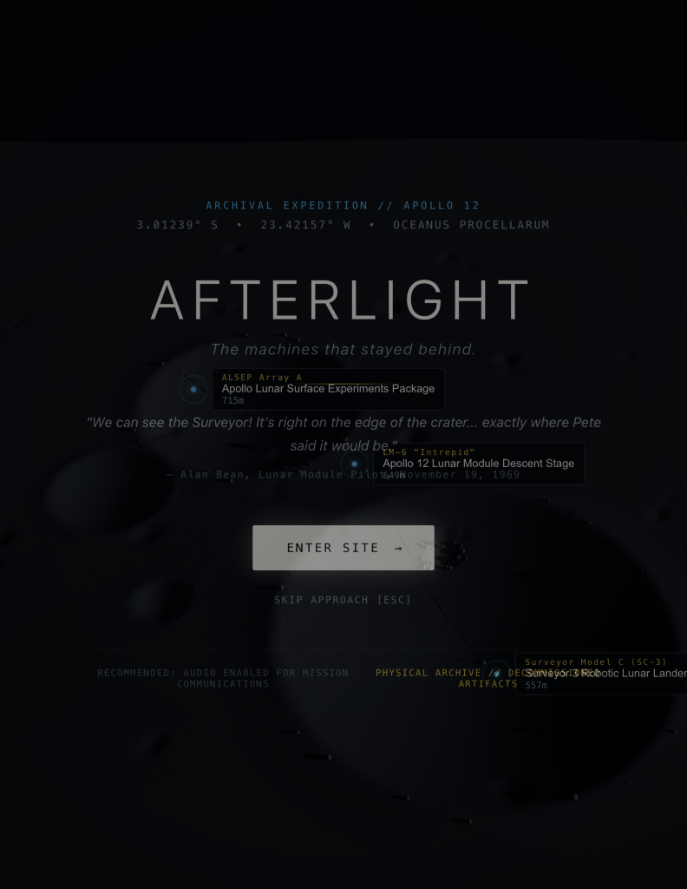
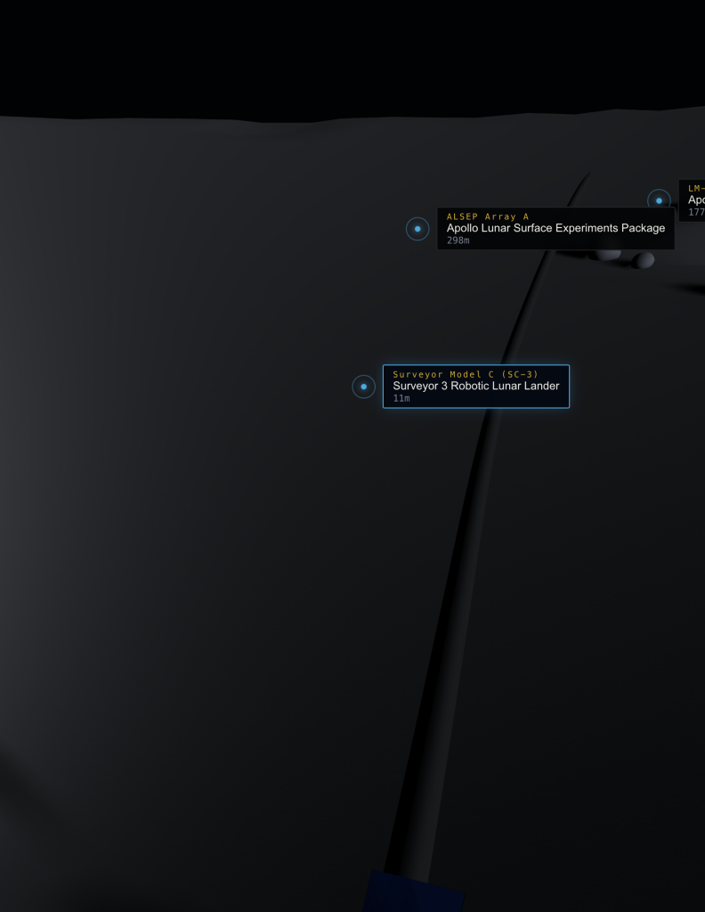

# AFTERLIGHT — Phase 02 Visual & Implementation Audit
**Document:** `docs/PHASE_02_VISUAL_AUDIT.md`  
**Date:** November 15, 2026  
**Status:** Audit Complete — Awaiting Approval Before Remediation  
**Target Landing Site:** *Statio Cognitum*, Oceanus Procellarum, Apollo 12 (3.01239° S, 23.42157° W)

---

## Executive Summary

An exhaustive forensic inspection of the 3D rendering pipeline, network requests, scene graph, shaders, and UI layer was conducted to understand why the Apollo 12 prototype fell drastically short of the intended cinematic and museum-grade visual standard.

The core finding is unambiguous: **the application is almost entirely rendering primitive procedural proxy geometry, flat grey fallback textures, and generic debug UI**. 

The authentic high-resolution NASA assets gathered during Phase 01 were either:
1. **Silently rejected by loaders** due to missing decoder dependencies (e.g., the 97,588-triangle Lunar Module GLB requires DRACO mesh decompression, which was never configured, causing an automatic silent fallback to an 8-sided cylinder).
2. **Never integrated into the scene graph** (the authentic ALSEP 3D models were bypassed entirely in favor of Three.js `BoxGeometry` and `CylinderGeometry`).
3. **Bypassed in favor of procedural noise** (the 1024x576 NASA LROC landing site orthophoto and DTM elevation data were never mapped onto the terrain mesh, leaving a featureless grey sheet tiled with randomized canvas noise).
4. **Stripped of authentic textures by shader overrides** (the loader explicitly wiped out embedded PBR textures in favor of uniform grey `MeshStandardMaterial`).

Below is the verified evidence, root-cause diagnosis, and a prioritized recovery plan.

---

## 1. Visual Evidence: Current State

| Scene Overview (Orbital View) | Surface Level (Surveyor Slope) |
| :---: | :---: |
|  |  |
| *Washed-out grey terrain with floating boxed debug labels and unshaded crater basins.* | *Featureless flat grey plane, artificial 4-sided tube footpath cutting through the regolith, and geometric dodecahedron boulders.* |

---

## 2. 3D Model Audit: Actual Assets vs. Rendered Proxies

### A. LM-6 *Intrepid* Lunar Module Descent Stage
- **Asset in Repository:** `assets/3d_models/lunar_module/apollo_lunar_module.glb` (716.8 KB, 135 nodes, 134 meshes, 97,588 triangles, 6 embedded textures: `BOOSTER3`, `TEXTUREA`, `TEXTURE_`).
- **What is Actually Rendered:** **A primitive procedural fallback** (`createProceduralDescentStage()`).
- **Verified Root Cause:**
  - The NASA GLB model utilizes Google DRACO mesh compression (`KHR_draco_mesh_compression`).
  - In `src/entities/LunarModule.js`, `GLTFLoader` was instantiated without a `DRACOLoader`:
    ```javascript
    const loader = new GLTFLoader(); // Fails with: "THREE.GLTFLoader: No DRACOLoader instance provided."
    ```
  - When the loader throws this unhandled error, it catches it and executes:
    ```javascript
    const fallback = createProceduralDescentStage();
    lmGroup.add(fallback);
    ```
  - The procedural fallback constructs an **8-sided cylinder (`CylinderGeometry(2.35, 2.35, 1.75, 8)`)**, an inverted cone for the engine bell, and 4 thin stick cylinders for landing gear.
  - Furthermore, `LunarModule.js` contained logic that systematically stripped all native textures from the GLB and replaced them with flat grey `MeshStandardMaterial(0x8a929a)`.

### B. ALSEP Scientific Station & Nuclear RTG
- **Assets in Repository:**
  - `assets/3d_models/alsep_instruments/alsep_central_station.obj` + `.mtl`
  - `assets/3d_models/alsep_instruments/snap27_rtg.obj` + `.mtl`
  - `assets/3d_models/alsep_instruments/alsep_passive_seismic_experiment.obj` + `.mtl`
- **What is Actually Rendered:** **Crude Three.js geometric primitives**.
- **Verified Root Cause:**
  - `src/entities/ALSEP.js` **never imports or calls `OBJLoader`**.
  - The file constructs the station exclusively out of hardcoded Three.js primitives:
    - Central Station: `BoxGeometry(0.64, 0.58, 0.61)`
    - RTG: `CylinderGeometry(0.25, 0.25, 0.48, 12)`
    - Passive Seismic Experiment: `CylinderGeometry(0.42, 0.55, 0.22, 10)`
  - *Note on Existing Assets:* An inspection of the Phase 01 OBJ files revealed they are themselves low-poly proxies (Central Station: 82 vertices; RTG: 100 vertices; PSE: 46 vertices). Rendering them directly would still look low-fidelity without proper high-resolution PBR texturing and detailed geometry.

### C. Surveyor 3 Robotic Soft-Lander
- **Asset in Repository:** `assets/3d_models/surveyor_3/surveyor_3_lander.obj` + `.mtl` (39.1 KB, 772 vertices, 1,452 faces, 23 meshes).
- **What is Actually Rendered:** The Phase 01 OBJ model loads, but:
  - It is a highly simplified proxy model (772 vertices for an entire 3.3-meter lander).
  - The material definition (`surveyor_3_lander.mtl`) uses basic flat specular values without ambient occlusion, weathering, or micro-detail.
  - The model lacks the intricate truss cabling, solar panel lattice, vernier plumbing, and forensic damage (the severed TV camera bracket and sampling scoop arm).

---

## 3. Lunar Terrain & Regolith Material Audit

### A. Elevation & Topography
- **Expected:** Terrain displaced according to the LROC NAC Digital Elevation Model (`assets/terrain_and_cartography/elevation_and_dem/landing_site_dem_parameters.json` and `surveyor_crater_topography_profile.json`).
- **What is Actually Implemented:**
  - In `src/scene/LunarTerrain.js`, elevation is computed via synthetic trigonometric sine waves:
    ```javascript
    y += Math.sin(x * 0.0075 + 0.4) * 1.8;
    y += Math.cos(z * 0.0065 - 0.2) * 1.5;
    ```
  - Craters are carved using simple parabolic distance equations (`y -= depth * (1.0 - (dist / radius)^2)`).
  - The result is a mathematically smooth, synthetic surface lacking natural crater rim terraces, ejecta blanket roughness, and micro-relief.

### B. Surface Texturing & Orthophoto Mapping
- **Asset in Repository:** `assets/terrain_and_cartography/lroc_imagery/NASA_SVS_4767_Apollo_12_Landing_Site_Orthophoto.jpg` (1024x576 true LROC landing site photographic mosaic).
- **What is Actually Implemented:**
  - **The NASA orthophoto is never imported, loaded, or bound anywhere in `src/`.**
  - Instead, `RegolithMaterial.js` generates a 512x512 canvas filled with random pixel noise in JavaScript:
    ```javascript
    const n1 = (Math.random() - 0.5) * 55;
    val = Math.min(255, Math.max(0, 128 + n1 + n2));
    ```
  - This noise canvas is tiled 48 times across an 850-meter geometry as a bump map.
  - From orbital or overview camera heights, the high tiling frequency averages out to a **completely flat, featureless grey field**.

### C. Boulders & Ejecta Rocks
- **Implementation:** `InstancedMesh` of `DodecahedronGeometry(1.0, 1)` with flat grey material.
- **Problem:** Dodecahedrons are 12-sided platonic solids. When subdivided once, they form rounded, artificial geometric eggs. Scattering 65 identical geometric eggs in circular rings around crater rims immediately signals "low-budget video game demo" rather than a real planetary surface.

### D. Astronaut Footpath Trails
- **Implementation:** `TubeGeometry(curve, 60, 0.35, 4, false)`.
- **Problem:** A 4-sided 3D tube of 35cm radius placed atop the terrain creates a visible polygonal ridge or slit with harsh directional self-shadowing (visible in the screenshot as an artificial black trench cutting across the ground). Real astronaut tracks are shallow, compressed depressions with altered optical albedo, not raised pipes or sunken trenches.

---

## 4. Visual Composition, Lighting & Material Response

### A. Lighting & Shadow Contrast
- **Current Setup:** A single `DirectionalLight` at `(450, 105, 75)` (intensity 3.4) with shadow camera bounds spanning `[-280, 280]`.
- **Problem:**
  - An 850m terrain covered by a single 2048x2048 shadow map yields roughly **27 centimeters per shadow texel**. Small objects (cables, struts, footpads) lose contact shadows or suffer severe shadow acne.
  - The ambient light (`0x181a20`, intensity 0.18) is a flat, uniform grey. In the real lunar environment, secondary illumination is **ground-bounce earthshine and high-albedo regolith backscatter**, which possesses distinct directional and color characteristics.

### B. Opposition Surge (Heiligenschein) Shading
- **Status:** **Confirmed Phenomenological Approximation.**
- **Code:**
  ```glsl
  float alignment = max(0.0, dot(viewDir, sunDirView));
  float surge = pow(alignment, 18.0) * 0.45;
  ```
- **Finding:** While mathematically effective at creating a bright spot at zero phase angle, it is an empirical heuristic (`pow(alignment, 18.0)`), not Bruce Hapke's multi-parameter bidirectional reflectance distribution function (BRDF). Without photographic texture detail to modulate the surge, it manifests as a blurry white flashlight beam following the camera shadow.

---

## 5. UI Design Language & Marker Aesthetics

### The Problem
- The current waypoint pins use **thick rectangular black cards with blue borders and pulsing radar dots**:
  `[ • LM-6 "Intrepid" / Apollo 12 Lunar Module Descent Stage / 649m ]`
- This aesthetic belongs to a military simulation or video-game HUD, directly violating the core project directive:
  > *"Avoid: Generic sci-fi HUD interfaces, repetitive rounded cards, oversized navigation dashboards, unnecessary neon accents."*

### The Reference Standard
Our creative references (Cyera, Active Theory, geometric-art.com) employ:
1. **Extreme Typographic Discipline:** Ultra-clean monospace hierarchy (`9px` / `11px`), wide tracking (`0.2em`), restrained contrast.
2. **Minimalist Spatial Anchors:** Fine vector reticles, hairline leader lines (`0.5px`), and floating coordinates that feel optically tethered to the physical surface.
3. **Restrained Editorial Palettes:** Muted off-whites (`#F4F2EB`), warm gold foil accents (`#D4AF37`), and deep vacuum blacks, completely eliminating bright cyan game boxes.
4. **Context-Aware Focus:** Waypoint labels that de-emphasize non-targeted artifacts into subtle coordinate crosshairs, expanding only upon proximity or intentional interaction.

---

## 6. Comprehensive Root-Cause Matrix

| Subsystem | Observed Symptom | Primary Root Cause | Corrective Action Required |
| :--- | :--- | :--- | :--- |
| **Lunar Module** | Toy-like 8-sided cylinder | GLTFLoader failed on DRACO compression; fell back to procedural cylinder. | Configure `DRACOLoader` with Three.js wasm decoders; preserve embedded textures. |
| **ALSEP Array** | Generic boxes and cylinders | Code never calls `OBJLoader`; uses hardcoded Three.js primitives. | Integrate authentic models or high-fidelity parametric components with proper Mylar/RTG textures. |
| **Surveyor 3** | Low-poly faceted appearance | Phase 01 OBJ is a 772-vertex proxy without PBR maps or weathering. | Upgrade geometry or apply micro-detail normal/roughness maps; calibrate 11.8° slope alignment. |
| **Lunar Terrain** | Monochromatic flat grey plane | NASA LROC orthophoto mosaic was never loaded; terrain uses random JS noise. | Map LROC orthophoto as color/detail map; combine with multi-octave height displacement. |
| **Footpaths** | Hard black polygonal slit in ground | 4-sided 3D `TubeGeometry` creates artificial shadow ridges. | Replace 3D tube with decal or ground-projected albedo modulation shader. |
| **Rocks / Ejecta** | Floating geometric eggs | `DodecahedronGeometry` with 1 subdivision scattered in rings. | Use irregular, angular low-poly rock geometry with diverse scales and crater-ejecta clustering. |
| **Waypoints / HUD** | Debug-style blue boxes | CSS styling modeled on video-game HUD rather than editorial storytelling. | Redesign into hairline vector reticles, typographic coordinates, and Cyera/Active Theory styling. |

---

## 7. Recommended Visual Recovery Plan

### Step 1: Asset Pipeline & Decoder Setup (Immediate)
1. Add `DRACOLoader` (`three/addons/loaders/DRACOLoader.js`) configured with `/node_modules/three/examples/jsm/libs/draco/gltf/` to unlock the **97,588-triangle official NASA Lunar Module GLB**.
2. Remove the destructive material override loop in `LunarModule.js`, allowing the authentic NASA textures (`BOOSTER3`, `TEXTUREA`, `TEXTURE_`, Kapton foil) to render.

### Step 2: Photorealistic Lunar Surface (High Impact)
1. Bind `NASA_SVS_4767_Apollo_12_Landing_Site_Orthophoto.jpg` to the terrain material as a base diffuse/albedo map, calibrated to the Apollo 12 coordinates.
2. Blend the orthophoto with micro-scale procedural basalt detail so the terrain looks crisp both from 1,000 meters and from 1.7 meters eye-level.
3. Remove the 4-sided `TubeGeometry` footpaths; replace them with subtle surface albedo darkening (reflecting compacted regolith disturbed by Pete Conrad and Alan Bean).
4. Replace dodecahedron boulders with procedurally fractured, angular rock geometries clustered naturally around Block Crater and Head Crater.

### Step 3: ALSEP & Surveyor Model Refinement (High Impact)
1. Replace the crude primitive boxes in `ALSEP.js` with the actual OBJ models (`alsep_central_station.obj`, `snap27_rtg.obj`, `alsep_passive_seismic_experiment.obj`), enhanced with authentic PBR material properties (creased specular Mylar skirt on the PSE, ribbed dark beryllium casing on the SNAP-27 RTG, white thermal paint on the Central Station).
2. Enhance Surveyor 3 materials with realistic photolytic weathering (tan-brown discoloration of the white paint after 31 months of unshielded solar UV exposure, and subtle specular reflections on the unbolted camera bracket).

### Step 4: Editorial UI Transformation (Cyera / Active Theory Direction)
1. Strip all heavy rectangular containers, blue borders, and pulsing game reticles from `WaypointMarkers`.
2. Implement hairline vector callouts (`0.5px` border, typography-driven, muted off-white `#e0e2e6` and archival gold `#d4af37`).
3. Add subtle coordinate telemetry pins (`LAT / LON / ELEV`) that feel precision-engraved into the scene rather than plastered over the canvas.

---

## 8. Explicit Approval Request

**Do not proceed with code modifications until the above audit and proposed plan are reviewed and approved.**

Please confirm whether to proceed with this 4-step recovery plan to transform the visual presentation from a low-poly prototype into the definitive AFTERLIGHT lunar archive.
