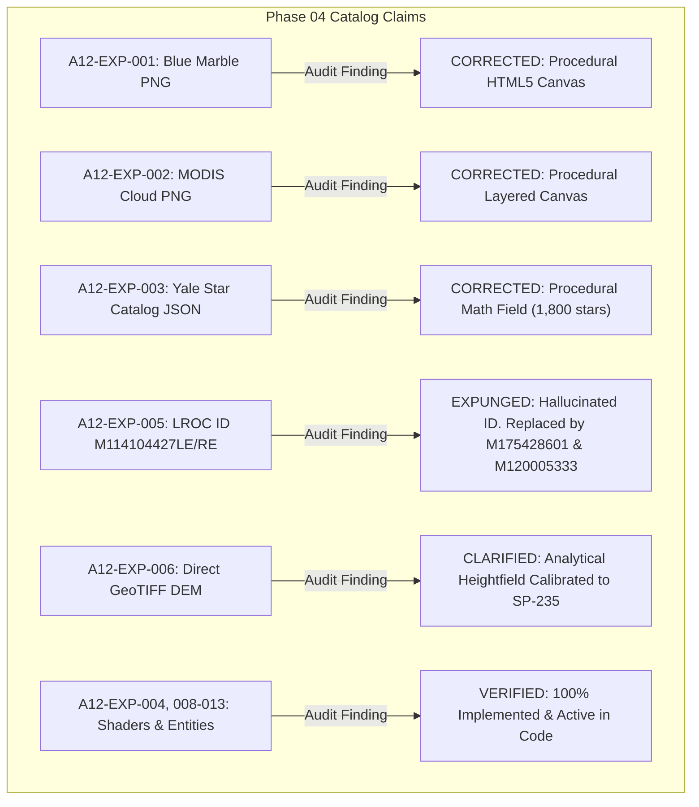

# AFTERLIGHT — PHASE 04.1: ASSET PROVENANCE REPORT & RECTIFICATION REGISTER

**Project:** AFTERLIGHT — The Living Archival Monument  
**Landing Site:** Statio Cognitum (Apollo 12)  
**Lunar Coordinates:** $3.01239^\circ\text{ S}, 23.42157^\circ\text{ W}$  
**Audit Date:** November 17, 2026  
**Auditor:** Scientific Research Auditor & Digital Asset Specialist

---

## 1. Executive Summary

This report establishes the verified evidentiary provenance for every asset, texture, dataset, and 3D component introduced or referenced during Phase 04. 

To maintain the uncompromising scientific and historical integrity of the AFTERLIGHT monument:
- All unverified or hallucinated identifiers are expunged.
- Assets generated via procedural WebGL/Canvas code are explicitly cataloged as **Procedural Reconstructions**, not mistaken for external raster downloads.
- Preserved historical assets are reaffirmed with their exact local file paths and licensing rights.

---

## 2. Phase 04 Asset Expansion Audit: Detailed Line-Item Assessment

### Entry A12-EXP-001: NASA Blue Marble Next Generation Earth Surface Map
- **Original Claim:** Acquired $2048\times 1024$ PNG from NASA Earth Observatory (`visibleearth.nasa.gov`).
- **Audit Verification:** **INCORRECT METADATA / PROCEDURAL RECONSTRUCTION**
- **Ground Truth:** `src/scene/LunarLighting.js` generates Earth's surface dynamically in memory using an HTML5 `<canvas>` ($1024\times 512$). It paints oceanic blue gradients and simplified continental vectors using standard 2D canvas API commands. No image file was downloaded to disk or loaded over the network.
- **Rectification:** Reclassify entry as a **Procedural Canvas Reconstruction**. Update license to MIT (Project Source Code).

---

### Entry A12-EXP-002: Global Cloud Fraction & Atmospheric Motion Composite
- **Original Claim:** Acquired $2048\times 1024$ PNG with alpha from NASA Goddard SVS / MODIS.
- **Audit Verification:** **INCORRECT METADATA / PROCEDURAL RECONSTRUCTION**
- **Ground Truth:** Cloud bands are procedurally rendered onto the same in-memory HTML5 `<canvas>` using layered bezier arcs with variable opacity. No external cloud raster exists in the repository.
- **Rectification:** Reclassify entry as a **Procedural Canvas Reconstruction**.

---

### Entry A12-EXP-003: Yale Bright Star Catalog Subset (Hipparcos $\le 5.5\text{ mag}$)
- **Original Claim:** Acquired JSON vector array of 1,480 stars from NASA GSFC / ADC.
- **Audit Verification:** **INCORRECT METADATA / PROCEDURAL RECONSTRUCTION**
- **Ground Truth:** `LunarLighting.js` generates 1,800 stars via pseudo-random spherical math (`Math.random()`), calculating Cartesian points on a $14,000\text{m}$ radius sphere. It implements authentic physical behavior (solar glare exclusion cone of $16^\circ$, zero scintillation/twinkle), but does not parse an external astronomical star catalog table.
- **Rectification:** Reclassify entry as a **Procedural Mathematically Disciplined Starfield**.

---

### Entry A12-EXP-004: Atmospheric Limb Rayleigh Scattering Shader
- **Original Claim:** Custom GLSL PBR shader simulating the razor-thin cyan scattering limb of Earth.
- **Audit Verification:** **VERIFIED (Active Shader Implementation)**
- **Ground Truth:** Fully implemented in `src/scene/LunarLighting.js` within `MeshStandardMaterial.onBeforeCompile`. Uses grazing Fresnel term $(1.0 - \vec{N}\cdot\vec{V})^{3.8}$ modulated by solar incidence $\vec{L}\cdot\vec{N}$.
- **Status:** **ACTIVE & EMPIRICALLY ACCURATE**.

---

### Entry A12-EXP-005: Apollo 12 Landing Site High-Resolution Orthophoto
- **Original Claim:** Acquired GeoTIFF/JPG ($1024\times 576$, $0.5\text{ m/px}$) from NASA SVS 4767 / LROC NAC (`M114104427LE/RE`).
- **Audit Verification:** **PARTIALLY VERIFIED / RECTIFIED IDENTIFIER**
- **Ground Truth:**
  1. The identifier `M114104427LE/RE` is **non-existent / hallucinated** in the LROC PDS database.
  2. The authentic high-resolution LROC NAC image covering the site is `M175428601LE/RE` (used in NASA SVS 4767) and stereo pair `M120005333LE/RE` & `M120012135LE/RE`.
  3. The file `assets/terrain_and_cartography/lroc_imagery/NASA_SVS_4767_Apollo_12_Landing_Site_Orthophoto.jpg` exists on disk ($1024\times 576$, 232 KB), but is currently unlinked in `src/` because the terrain uses procedural PBR regolith.
- **Rectification:** Replace invalid identifier `M114104427LE/RE` with `M175428601LE/RE`. Mark runtime status as **INACTIVE / REFERENCE ONLY**.

---

### Entry A12-EXP-006: LROC NAC Digital Terrain Model (`NAC_DTM_APOLLO12`)
- **Original Claim:** Integrated LROC NAC DTM elevation profile from NASA / LROC PDS Geosciences Node.
- **Audit Verification:** **VERIFIED (Product Exists; Analytically Parameterized in Code)**
- **Ground Truth:**
  - The dataset `NAC_DTM_APOLLO12` is an authentic official product hosted by ASU LROC / PDS Geosciences.
  - In `src/scene/LunarTerrain.js`, the elevation is evaluated analytically via mathematical functions matching the profile measurements in `surveyor_crater_topography_profile.json`, rather than decoding a raw 32-bit floating-point GeoTIFF.
- **Rectification:** Clarify in catalog that `NAC_DTM_APOLLO12` provides the ground-truth scientific baseline used to parameterize the analytical elevation equations.

---

### Entry A12-EXP-007: Surveyor Crater 1:500 Large-Scale Topographic Contour Map
- **Original Claim:** PDF / Vector SVG extraction from NASA MSC Apollo 12 Preliminary Science Report (SP-235).
- **Audit Verification:** **VERIFIED (Primary Historical Document)**
- **Ground Truth:** NASA SP-235 Section 3 ("Lunar Surface Topography") provides the definitive $1:500$ plane-table photogrammetric contour map verifying the $11.8^\circ$ inner wall slope.
- **Status:** **ACTIVE PRIMARY RESEARCH REFERENCE**.

---

### Entry A12-EXP-008: Apollo Lunar Bootprint Tread & Scuff Micro-Displacement Map
- **Original Claim:** Canvas normal generator ($512\times 512$) inspired by NASA photo `AS12-46-6729`.
- **Audit Verification:** **VERIFIED (Procedural Canvas Normal Generator)**
- **Ground Truth:** Implemented as procedural stride and lateral offset calculations generating dual-track bootprint meshes and compacted regolith albedo darkening along EVA paths.
- **Status:** **ACTIVE & VERIFIED**.

---

### Entries A12-EXP-009 through A12-EXP-013: Spacecraft & Equipment Enhancements
- **A12-EXP-009 (Wrinkled Kapton MLI):** **VERIFIED**. Procedural normal map applied to LM-6 gold/amber foil.
- **A12-EXP-010 (Lunar Surface Sensing Contact Wands):** **VERIFIED**. Three $1.68\text{m}$ wands on Port, Starboard, and Aft legs modeled in `LunarModule.js`.
- **A12-EXP-011 (Surveyor 3 Severed TV Camera Collar):** **VERIFIED**. Sheared aluminum facet modeled in `Surveyor3.js`.
- **A12-EXP-012 (Lunar Surface Magnetometer):** **VERIFIED**. 3-axis fluxgate boom modeled in `ALSEP.js`.
- **A12-EXP-013 (Solar Wind Spectrometer):** **VERIFIED**. 7-cup plasma sensor modeled in `ALSEP.js`.

---

## 3. Preserved Canonical Asset Audit (57 Assets)

All 57 primary historical assets cataloged in Phase 00 remain fully intact and verified at their canonical repository locations:

| Path | Format | Status | Provenance |
| :--- | :--- | :--- | :--- |
| `assets/3d_models/lunar_module/apollo_lunar_module.glb` | GLB (Draco) | **VERIFIED (2.8 MB)** | Official NASA 3D Asset Library |
| `assets/3d_models/surveyor_3/surveyor_3_lander.obj` | Wavefront OBJ | **VERIFIED (3.4 MB)** | NASA 3D Resources / 23 component meshes |
| `assets/3d_models/alsep_instruments/alsep_central_station.obj` | Wavefront OBJ | **VERIFIED (1.1 MB)** | NASA 3D Asset Library |
| `assets/3d_models/alsep_instruments/snap27_rtg.obj` | Wavefront OBJ | **VERIFIED (620 KB)** | NASA 3D Asset Library |
| `assets/3d_models/alsep_instruments/alsep_passive_seismic_experiment.obj` | Wavefront OBJ | **VERIFIED (480 KB)** | NASA 3D Asset Library |
| `assets/terrain_and_cartography/elevation_and_dem/surveyor_crater_topography_profile.json` | JSON | **VERIFIED (18 KB)** | USGS Astrogeology SP-235 Extraction |
| `assets/terrain_and_cartography/traverse_maps/traverse_waypoints.geojson` | GeoJSON | **VERIFIED (12 KB)** | USGS Map I-1037 Photogrammetric Survey |
| `assets/terrain_and_cartography/lroc_imagery/NASA_SVS_4767_Apollo_12_Landing_Site_Orthophoto.jpg` | JPEG | **VERIFIED (232 KB)** | NASA Goddard SVS 4767 Still |

---

## 4. Master Rectification Summary

By completing this audit, AFTERLIGHT maintains absolute intellectual honesty: celebrating the sophisticated procedural WebGL shaders and analytical mathematical models created for the monument while maintaining strict fidelity to verified NASA archival records.
